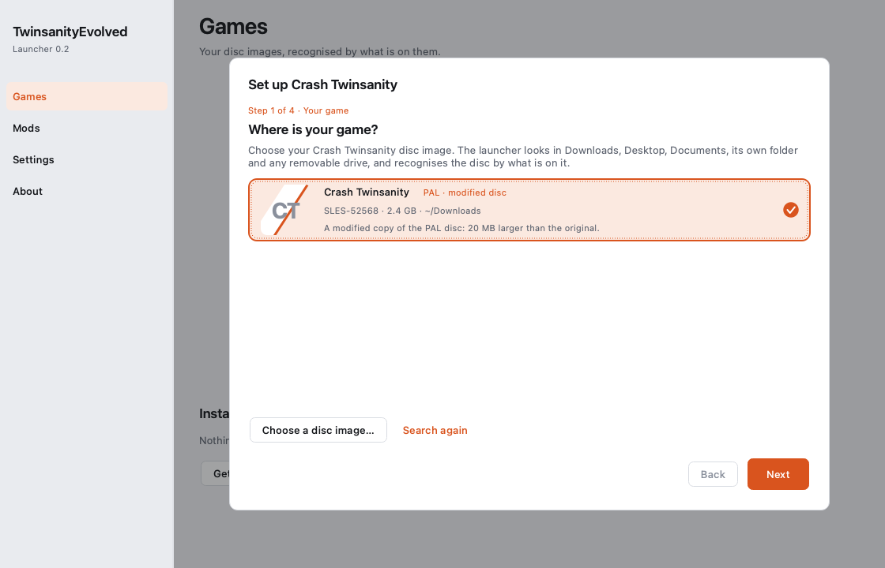
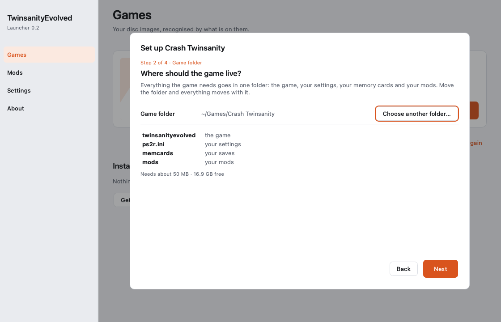
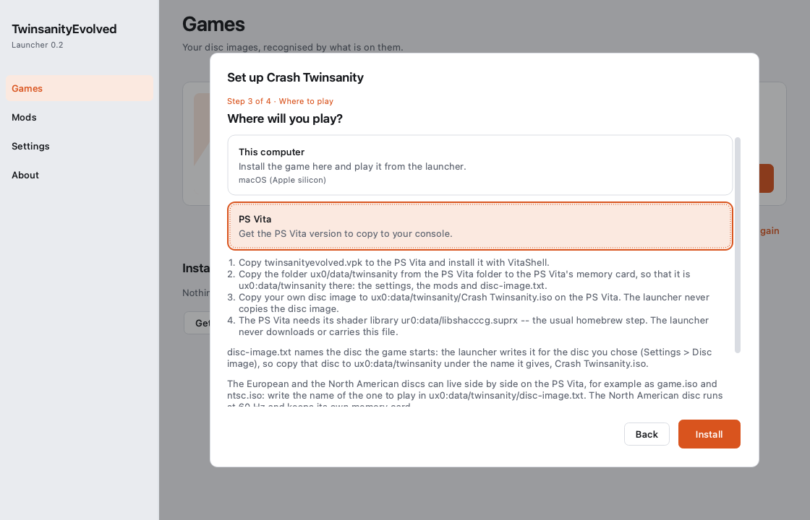
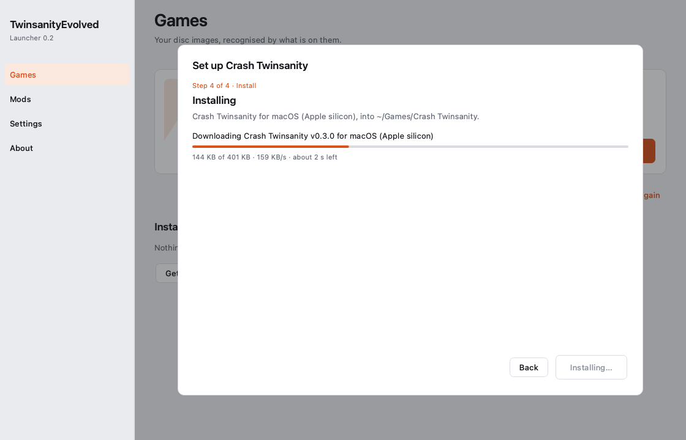
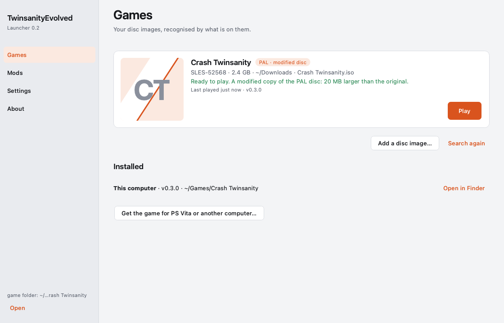
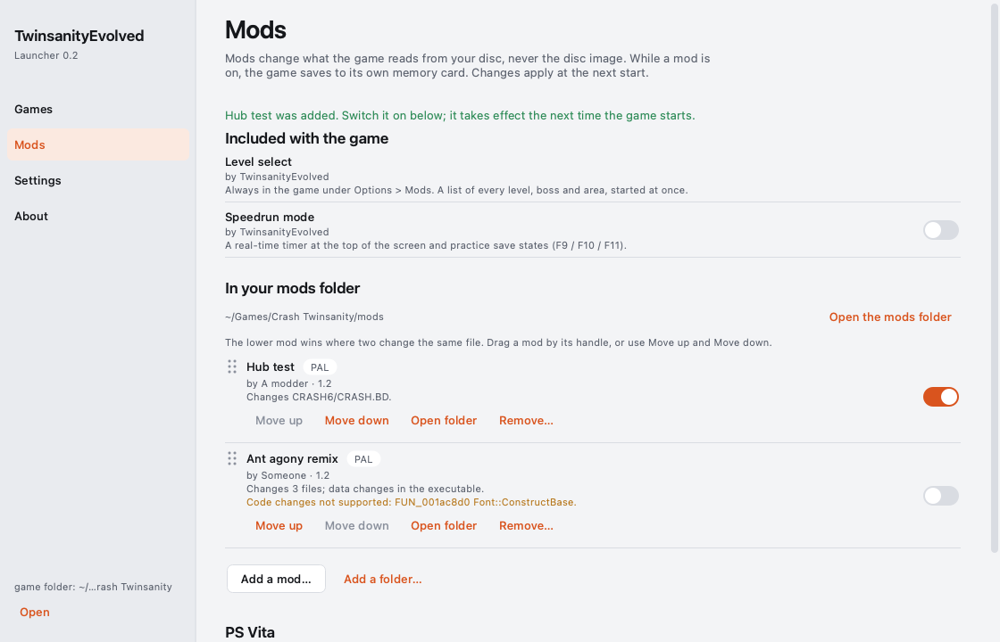
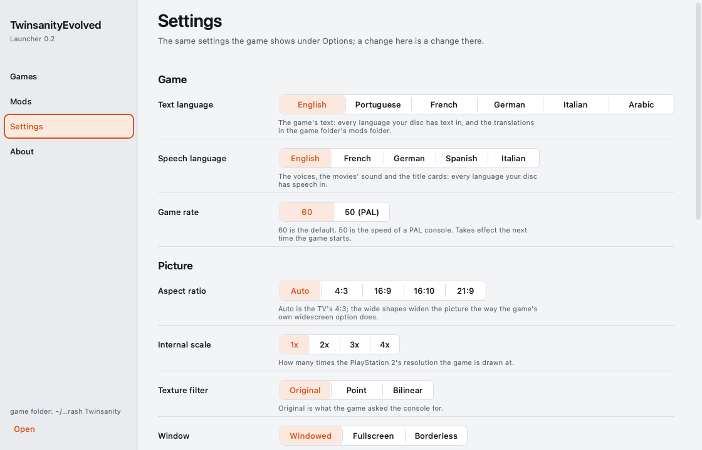
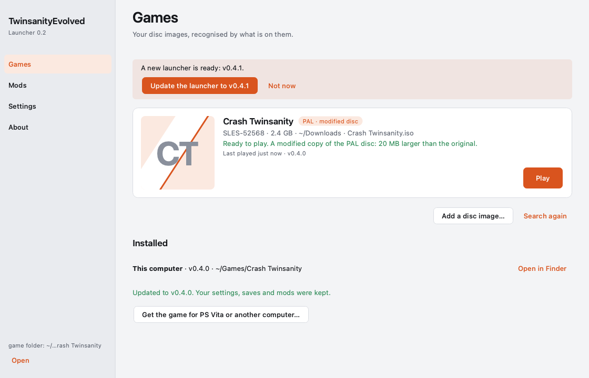
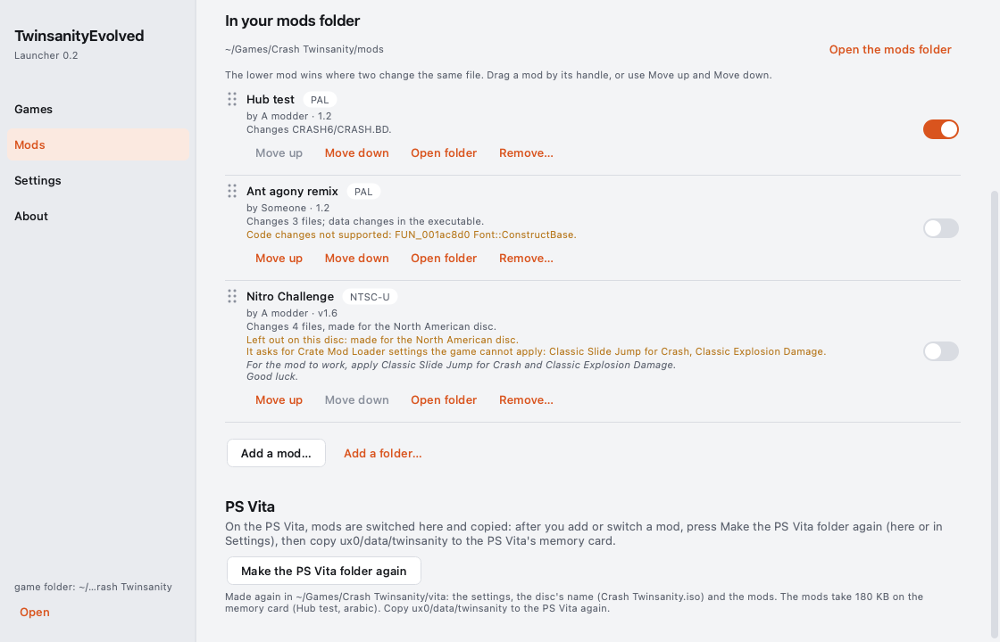

# TwinsanityEvolved

Native PC port of Crash Twinsanity: the [twinsanity-reversed](https://github.com/Smartkin/twinsanity-reversed)
decompilation (`game/`) running on the NativeEE engine (`engine/`).
The game is compiled to wasm32 and lowered to C with wasm2c; its linear memory is the engine's 32 MB main memory; the
decompilation's own `include/platform/*.h` is the only seam. No game data of any kind is in this repository — you need your
own disc image, which is read at run time.

## What's new

Since v0.1.8 (the full list for players is in [RELEASE-NOTES.txt](RELEASE-NOTES.txt)):

- **The launcher installs the finished game** for Windows, macOS, Linux or the PS Vita from the releases, into one game
  folder that holds the game, your settings, your memory cards and your mods.
- **The North American disc plays**, and every disc is recognised by its content against the known dumps of the
  original discs.
- **Mods:** mods packaged as Mod Crates are supported, as are patched disc images, xdelta / PPF / BPS patches, folders of
  files and single archive files, added on the launcher's Mods page or with the mod tool.
- **Languages:** the text and the speech are two settings, and the game's texts can be read in Arabic.
- **PS Vita:** a package in every release, the PAL console's 50 Hz game loop, its movies, shadows and title sequence
  fixed, and a steadier, faster picture.
- **Fixed:** at 50 Hz the game no longer plays in slow motion, on every system.

## Play: download the game

1. From the latest release, download the zip for your system: `twinsanityevolved-<version>-windows-x64.zip`,
   `-macos-arm64.zip` (Apple silicon), `-macos-x86_64.zip`, `-linux-x86_64.zip` or `-linux-aarch64.zip`.
2. Unzip it anywhere you like, on any drive.
3. Start `twinsanityevolved` (`twinsanityevolved.exe` on Windows). The first time, it asks for your disc image: choose
   your own Crash Twinsanity image (`.iso`) -- the **PAL** disc (SLES-52568) or the **North American** disc (SLUS-20909
   v2.00). That is all: nothing is installed, nothing else is downloaded, and nothing is written outside the game's folder.

The game remembers your disc in `disc-image.txt` and keeps its memory cards and settings in `userdata\` beside it
(an earlier install's `~/.twinsanityevolved` keeps being used if you have one). Deleting the folder removes everything.
The zip holds only the program, the mod tool (`twinsanityevolved-modtool`, see Mods), the Arabic language pack
(`mods/arabic`, see Arabic), their libraries and the licences: no game data, which is read from your disc while you play (every release
zip passes `tools/ci/asset_scan.py`, which fails on any disc file or game asset).

**50 Hz.** A PAL console runs the game at 50 frames a second; the port runs it at 60 by default. For the PAL console's own
50 ticks a second, open Options → graphic options → **game rate** and choose **50 hz (pal)**: it takes effect the next time
the game starts (the setting is `game.hz = 50` in `userdata/ps2r.ini`; `--hz 50` does the same for one run). The game moves
at the same real-time speed at either rate (its clock counts real time: each 50 Hz frame is 1/50 s of game time). At 50 Hz
the frame rate row's `60` shows every frame the game makes, i.e. 50 frames a second.

## The launcher

The launcher (`twinsanityevolved-launcher-windows-x64.zip`, `twinsanityevolved-launcher-macos-arm64.dmg` or
`twinsanityevolved-launcher-linux-x86_64.AppImage` on the release) does all of the above for you. You need two things:
your Crash Twinsanity disc image and the launcher. The first time it opens, one sheet asks four questions; nothing is
typed, and Back always works.

1. **Where is your game?** The launcher looks in Downloads, Desktop, Documents, its own folder and any removable drive,
   and recognises your disc by what is on it: the region (PAL, NTSC-U, NTSC-J) and whether it is the original disc --
   the whole image is compared with the known dumps of the original discs, a few seconds the first time -- or a modified
   copy ("PAL · modified disc"). Drop the file on the window, or choose it, if it is somewhere else.
2. **Where should the game live?** One folder, `~/Games/Crash Twinsanity` (`%USERPROFILE%\Games\Crash Twinsanity` on
   Windows) unless you choose another. The game, your settings (`ps2r.ini`), your memory cards (`memcards`) and your
   mods (`mods`) all live in it: move the folder and everything moves with it.
3. **Where will you play?** This computer, a PS Vita, or another computer (Windows, macOS, Linux).
4. **Installing.** The finished game for that machine comes from the latest release, is checked against the release's
   checksums and is put in the folder. Then **Play**.






After that the launcher has four pages: **Games** (your discs, each with Play; **Update** when a new version is out),
**Mods** (the mods that come with the game and the ones in your mods folder, each with a switch and a line saying what it
changes; drop a mod crate, a patched disc image, a patch file, a folder of files or one file of the game's archive on the
page to add it; drag the mods into order, the lower one wins where two change the same file; a change takes effect the
next time the game starts),
**Settings** (the game's own Options in plain language: the same `ps2r.ini` the in-game menu writes, so a change in one is
a change in the other; its **Text language** and **Speech language** offer what your disc carries, see Language) and
**About**.





**The launcher updates itself.** Each time it opens, the launcher looks for a newer launcher in the releases. When there
is one, the Games page says `A new launcher is ready: vX.` with **Update the launcher to vX**: the new launcher is
downloaded, checked against the release's checksums, put in the place of the one you opened, and opened again by itself;
your games, settings, saves and mods stay as they are (About has **Check for a newer launcher**). Where it cannot replace
itself -- a folder your account cannot change, such as Applications for a standard account, or the launcher opened
straight from its disk image -- it says why, and **Download it** opens the release's page. The game itself is updated as
before, with **Update** on its card. On macOS the launcher is not signed by Apple: after an update macOS may ask again
before the launcher reads a disc image in Downloads, Desktop or Documents.



**PS Vita.** Choose PS Vita in step 3 (or **Get the game for PS Vita or another computer…** on the Games page) and the
launcher makes a folder ready to copy, `vita/` in your game folder: `twinsanityevolved.vpk`, `README-vita.txt` with the
steps, and `ux0/data/twinsanity/` as the console's memory card has it -- your game folder's settings (`ps2r.ini`, without
the computer's own folders, picture size, window and game rate: the PS Vita has its own), a copy of the language packs and
of the mods you switched on, and `disc-image.txt` naming your disc's file name. Then:

1. Copy `twinsanityevolved.vpk` to the PS Vita and install it with VitaShell.
2. Copy `ux0/data/twinsanity` to the PS Vita's memory card, so that it is `ux0:data/twinsanity` there.
3. Copy your own disc image into `ux0:data/twinsanity/` under the name `disc-image.txt` gives (the launcher never copies the
   disc image; without `disc-image.txt` the game starts `ux0:data/twinsanity/game.iso`).
4. The PS Vita needs its shader library `ur0:data/libshacccg.suprx` -- the usual homebrew step. The launcher never
   downloads or carries this file.

After you import a mod, switch one on or off or change a setting, **Make the PS Vita folder again** -- at the foot of the
Mods page, under PS Vita, and on the Settings page -- brings the folder up to date (only what changed is copied); copy
`ux0/data/twinsanity` again. Mods are added and switched on the computer, never on the PS Vita. The launcher's About page
has the whole PS Vita flow in six sentences. On the PS Vita, `ux0:data/twinsanity/disc-image.txt`
switches discs: two can sit side by side (`game.iso` and, say, `ntsc.iso`) and the file's one line names the one the game
starts with (a file name beside `game.iso`, or a full `ux0:` / `uma0:` path). The North American disc plays there as on a
computer -- at 60 Hz (the PS Vita's 50 Hz default is the PAL disc's), with its own memory card
(`ux0:data/twinsanity/memcards-SLUS-20909`) and English only in the two language rows; the mods in
`ux0:data/twinsanity/mods` and the Arabic language pack work as they do on a computer. Importing a mod is the launcher's
job, on a computer. The PS Vita's resolution row offers 1x or 2x: 2x, the console's maximum, runs at half the frame rate or
less, and a `ps2r.ini` that names 3x or 4x is read as 2x.



The launcher keeps only its own notes (the discs it knows, its window, its logs) in its app-data folder
(`%LOCALAPPDATA%\TwinsanityEvolved` on Windows, `~/Library/Application Support/TwinsanityEvolved` on macOS,
`~/.local/share/TwinsanityEvolved` on Linux); deleting that folder removes them. The game folder is yours. Every screen
of the launcher is in `docs/launcher/screenshots/`.

## Mods

Mods change what the game reads from your disc, never the disc image itself. Add one on the launcher's **Mods** page (drop
it on the page, or **Add a mod…**) or with `twinsanityevolved-modtool`, which comes with the game, and switch it on there:
the launcher's Mods page is where the mods of your mods folder are switched, and the game starts with them in place. A
change takes effect the next time the game starts. What a mod is, is decided by what
is in it, never by its name; mods are taken as the community ships them:

- **Mod Crates** -- the community's usual shape, made for Crate Mod Loader: a `.zip` or a folder with `ModCrateInfo.txt`,
  `layer0/` (files of the disc) and `layer1/` (entries of the game's archive). A large crate (over a gigabyte) takes about
  half a minute to add. The author's notes in `ModCrateInfo.txt` are shown under the mod on the launcher's Mods page.
- **A patched disc image** (`.iso`): only the files that differ from your disc are kept.
- **A patch made against the original disc** -- xdelta, PPF or BPS: applied to a temporary copy of your disc (its free
  space is checked first; the copy is removed afterwards), then kept as the files that differ.
- **A folder of files** laid out like the disc, loose files such as a whole `CRASH.BD` + `CRASH.BH`, or a folder that is
  already a mod (`mod.json`).
- **One file of the game's archive** -- what the Twinsanity Editor writes: a level chunk (`.rm2`, `.sm2`), a picture
  (`.psm`), a text bank (`.txt`), passed around bare like a `Default.rm2`. It is placed by its name: the one entry of the
  archive with that name is replaced (`Default.rm2` becomes the mod `default`). A name several entries share
  (`English.txt`) is refused with them listed: put the file in folders named like the one it replaces.

Each becomes one folder of your mods folder (`<game folder>/mods/<id>/`, described by its `mod.json`), holding only
what the mod changes. Where two mods change the same file, the lower one on the launcher's Mods page wins.

**The same mod again replaces it.** A mod's id is its name (`My Level Pack` -> `my_level_pack`);
adding a mod whose id you already have -- a new version of it, or the same file again -- replaces the one you have once
the new one is complete. The launcher asks first ("Replace <name> <version>? The copy you have is removed
first."; Cancel adds nothing), the mod tool replaces it; the mod keeps its switch and its place in the order. A folder of
that name that is not a mod is never touched: the addition stops and says so.

```sh
twinsanityevolved-modtool import "a mod crate.zip" --iso "/path/to/your disc.iso" --mods "<game folder>/mods"
twinsanityevolved-modtool inspect "a patch.xdelta" --iso "/path/to/your disc.iso"       # what it is, without adding it
twinsanityevolved-modtool verify "<game folder>/mods/<id>" --iso "/path/to/your disc.iso"   # every file, byte for byte
```

**A mod is made for your disc.** Its folder records the files it was made over, and the game checks them when it
starts: a mod added with one disc and played with another (whose files differ) is left out, with a line in the game's
log. The European and the North American discs are different discs: a mod made for the North American disc carries the
`NTSC-U` badge on the launcher's Mods page, and on a European game folder its row says "made for the North American
disc"; when it was made over that disc's files (an imported crate's archive is), the game leaves it out at its start and
the row says so in amber: "Left out on this disc: made for the North American disc." One file of the archive made for
the other disc is refused when it is added ("... it was made for the European disc").

**Not supported** -- refused with a sentence saying why, or listed under the mod:

- **Code changes in a modified executable.** A mod's `SLES_525.68` is used for its data (tables, texts, numbers: those
  apply), but this port runs its own code, not the executable's: changed code is listed under the mod on the launcher's
  Mods page ("Code changes not supported: ...") and does not apply (new code a crate adds is such a change).
- **`ModCrateSettings.txt`** -- the property edits Crate Mod Loader makes to the game's code -- and crates with scripts.
  The same settings asked for in a crate's notes ("apply Classic Slide Jump for Crash and Classic Explosion Damage")
  cannot be applied either: the mod is added, and its row says so in a warning.
- **xdelta patches with secondary compression** (`-S djw`, `fgk` or `lzma`; xdelta3 3.1 with LZMA support uses LZMA by
  default): apply such a patch yourself (xdelta3, Delta Patcher) and add the patched image.
- RAR and 7-Zip archives, CHD / CSO / ECM images, `.cue` sheets, UPS and IPS patches, encrypted zips; emulator texture
  packs and cheat codes (they are not disc content).

**The built-in mods** come with the game, off by default:

- `level select` — one row that opens the list of the game's levels, bosses and areas at once; choosing one starts it through
  the game's own saved-level path (from the main menu as a new game would, from the pause menu with the current progress).
- `speedrun mode` — one real-time timer (mm:ss.cc) in the game's font, centred at the top of the safe area, started at NEW
  GAME or the first level entered. The in-game time and a split on every level entry / exit are written into a
  `--record-pad` recording (`# split …` lines: a recorded run carries its timer and its splits). Practice save states on a
  ring of 8: F9 saves, F10 loads the newest in place, F11 the one before (`~/.twinsanityevolved/practice/`); F12 or Mods >
  speedrun > reset to run start resets.

**In the game**, OPTIONS > MODS lists the built-in mods, which apply at once: `level select` and `speedrun mode : off|on`.
The mods of your mods folder are not on it: they are switched on the launcher's Mods page (or with `mods.<id>.enabled` in
`ps2r.ini`) and the game starts with them in place (a change made while the game runs takes effect at its next start). A
language pack (the Arabic one) is not a mod: it is on neither Mods page and is chosen as a text language (see Arabic).
While ANY mod is on, the game saves to its own memory card (`memcards-mods`, seeded from the vanilla
card the first time): a modded save never touches the vanilla card. In `ps2r.ini`: `mods.<id>.enabled = on|off` and
`mods.order = id,id,...`; `--mod <id>` switches one on for a run.

## Discs

The game and the launcher recognise a disc image by what is on it, never by its file name:

- **The original disc** is a known retail dump: the whole image -- its size, CRC-32 and SHA-1 -- matches one of
  redump.org's (`launcher/discs/redump.json`: the European SLES-52568 v1.01, the North American SLUS-20909 v1.00 and
  v2.00, the Japanese SLPM-65801). The launcher reads the whole image once (seconds; remembered) and shows
  `PAL · original disc` or `NTSC-U · original disc`; the game compares the size at every start, and the whole image with
  `--verify-disc`.
- **A modified copy** -- the original program with other files, such as a translation patch -- shows
  `PAL · modified disc` and plays as the original does. The disc this port was made with is one: a PAL image with a
  Portuguese translation patch, 20 MB larger than the original. Which files it changes cannot be named: the repository
  holds only the dumps' sizes and hashes, no file list of an original disc.
- **An unrecognised version** -- the game's files with a program that is no known release -- is accepted with a warning
  (`PAL · unrecognised version`).
- **The North American disc plays** (`NTSC-U · original disc`, SLUS-20909 v2.00): there is nothing to do but choose it.
  The port runs the European program's code; the North American program's data is laid out at the European addresses
  through an address map built into the game (`launcher/discs/region_map_SLUS-20909.json`: addresses and names only, no
  byte of either disc), at 60 fields a second (`game.hz = 50` does not apply), in its one language (English, with its own
  voices), with its own movies, and with its own memory card (`memcards-SLUS-20909` beside `memcards`). What it cannot
  have is the North American program's own code changes: the game plays them the European way.
- **The Japanese disc, and the North American v1.00 disc,** are recognised but **not playable in this version**: each
  needs its own address map, made once from two discs by someone who has both:

  ```sh
  twinsanityevolved-modtool region-map --pal "/path/to/the European disc.iso" --disc "/path/to/the other disc.iso" --out region_map_<serial>.json
  ```

  Put the map beside the game (or pass `--region-map FILE`).

## Arabic

The game's texts in Arabic: every menu, notice and hint (305 texts, our own translation), drawn right to left in Arabic
letters made for this port in the game's lettering style. It is a **language pack**, not a mod: `mods/arabic` in this
repository and in every release zip, which the launcher puts into your game folder's `mods/` when it installs or updates
the game (a copy you removed or changed is left alone); without the launcher, copy the zip's `mods/arabic` into your mods
folder (the Vita: `ux0:data/twinsanity/mods/arabic`). There is nothing to switch on: while it is in the mods folder,
OPTIONS > GAME OPTIONS > **TEXT LANGUAGE** offers **arabic** after the disc's text languages (and the launcher's Settings,
**Text language**, offers **Arabic**). It is on neither Mods page, and the game keeps saving to your usual memory card.

- **The speech** is the SPEECH LANGUAGE row's: any language your disc speaks (English unless you choose another).
- The credits, the title cards and the legal screen are the disc's pictures in the speech's language, and a few memory card
  messages the game's program carries itself stay English.
- It is offered only on a disc whose English texts are the ones it translates (made on a PAL disc, SLES-52568); on another
  disc (the North American one) it is simply not offered.
- To redo the translation, or to make another language: `tools/text/README.md` (and **Languages** further down this page).

## Play from a terminal

```sh
# the PAL disc (SLES-52568): the decompilation is the PAL executable; the image is read at run time only
twinsanityevolved --iso "/path/to/Crash Twinsanity (Europe).iso"      # play: a window at the TV's 4:3, the boot movies, 60 Hz logic
twinsanityevolved --iso "...iso" --skip-movies                        # straight to the legal screen / title
twinsanityevolved --iso "...iso" --language french                    # the text AND the speech language (english default): see Language below
twinsanityevolved --iso "...iso" --text-language portuguese           # the text's language alone for one run (game.text_language)
twinsanityevolved --iso "...iso" --speech-language spanish            # the speech's language alone for one run (game.speech_language)
twinsanityevolved --iso "...iso" --aspect 16:9                        # the picture's shape for one run; see Display below
twinsanityevolved --iso "...iso" --mc-dir ~/.twinsanityevolved/memcards  # the memory card folder (default: userdata/memcards beside the game)
twinsanityevolved --iso "...iso" --hz 50                              # the PAL console's 50 Hz for one run (default 60; game.hz in ps2r.ini)
twinsanityevolved --iso "...iso" --present-ct16                       # the retail look: the frame shown as the PS2's dithered 16-bit copy
twinsanityevolved --iso "...iso" --fps-counter on                     # the shown fps + game Hz top-right in the game's own font
twinsanityevolved --iso "...iso" --frame-rate 120                     # the presenter's cadence for one run (30|60|120|144|240|uncapped); see Frame rate below
twinsanityevolved --iso "...iso" --mod level_select                   # a built-in mod on for this run (not persisted); see Mods below
twinsanityevolved --iso "...iso" --mods-dir "<game folder>/mods"      # the mods folder for this run (default: beside ps2r.ini)
twinsanityevolved --iso "...iso" --verify-disc                        # the whole image against the known dumps at boot (seconds); see Discs
```

Release zips (`twinsanityevolved-<platform>.zip`, one per platform) contain the game, the mod tool
(`twinsanityevolved-modtool`), this README and the licences. Unzip and run the command above with your disc image.
Closing the window quits.

**Display.** The title's OPTIONS > GRAPHIC OPTIONS page carries the port's display rows beside retail's centre screen and
widescreen: aspect ratio (auto = the TV's 4:3 / normal / wide / 16:10 / ultra-wide), resolution (1x..4x: the PS2's own size and its multiples), texture filter
(original / point / bilinear), vsync, display mode (windowed / fullscreen / borderless) — applied at once and written to
`~/.twinsanityevolved/ps2r.ini` (`video.aspect`, `video.scale`, `video.texture_filter`, `video.vsync`, `video.fullscreen`;
the centre-screen move as `video.custom_offset_x/y`). The page's last row is the FPS COUNTER (labelled "fps overlay", off by
default): the SHOWN fps over the game Hz, top-right, drawn with the game's own menu font; `display.fps_counter` in ps2r.ini,
`--fps-counter on|off` for one run.

**Frame rate.** The same page's FRAME RATE row (after VSYNC): 30 · 60 · 120 · 144 · 240 · uncapped, default 60; applied at
once, written as `video.frame_rate` in ps2r.ini, `--frame-rate <value>` for one run. The game always runs at normal speed:
its logic ticks at exactly 60 Hz whatever the row says (the census's `game_hz 60.0`, no catch-up, no slow motion) and
produces the same 60 pictures a second — the row decides how those pictures are SHOWN.

- **30** shows every other picture at a steady cadence (no interpolation).
- **60** shows every picture as the game makes it (today's behaviour).
- **120 / 144 / 240** present at that rate, paced by a high-resolution timer (on Windows the waitable timer, never Sleep);
  the frames between two game pictures are interpolated — the camera's position, orientation and field of view, every
  rigid object's position, rotation and scale, the characters' skins — from the two real pictures, never ahead of them
  (one game tick of added latency, measured and reported). With VSYNC on the display's refresh is the effective cap
  (a 60 Hz display shows 60 of the 120): the page says so under the row while one of these is selected.
- **uncapped** presents every frame the renderer can make, interpolated, and forces vsync off for the session: the VSYNC
  row reads "off (uncapped)" and cannot be changed until another rate is chosen.

Text, the HUD, the pause and options menus, the FMV pictures and the title's orb are always the newest picture's. The runner's exit lines carry the presenter's row
`present=rate:shown_fps:interp_frames:snaps:latency_ms:late_presents`.

**Frame rate on the PS Vita.** The Vita's screen is 60 Hz and its FRAME RATE row is the game's own cadence instead:
**auto (60/30)** (the default) runs the game at 60 while its ticks fit a refresh and otherwise locks it to a steady 30
(20 in the heaviest scenes): each tick then spans two (three) refreshes of game time -- the game integrates by time, as the
PS2 game does when it drops frames -- every picture is drawn and the display holds each one exactly that long, so the
picture moves evenly instead of swinging between 20 and 60. **60** and **30** fix the cadence. The loading screens, the
boot and the movies always run one refresh per tick. The setting is `display.tick_lock = auto | 60 | 30` in ps2r.ini
(`--frame-rate auto|60|30` for one run; `TE_VITA_TICK_LOCK=auto|60|30|20|ab` in args.txt overrides it, `ab` alternating
auto and 60 every 600 presents for a comparison); the log's `[te.vita.lock]` lines give the cadence of every window.

**The PS Vita's game rate is the PAL disc's own 50 Hz.** On the Vita `game.hz` defaults to 50 (a ps2r.ini without the key,
or none yet); Options → graphic options → **game rate** writes it (`60` or `50 hz (pal)`), taken at the next start. An
args.txt replaces the built-in arguments: its own `--hz` decides for its run, or `game.hz` / the default 50 when it names a
ps2r.ini, or 60 with `--config none`; the log's first lines say which (`vita: game rate 50 Hz (the Vita's default 50:
ps2r.ini has no game.hz)`, `(ps2r.ini game.hz = 60)`). At 50 Hz the game loop ticks 50 times a second as the developers'
PAL loop did, paced by a 20 ms timer, and the 60 Hz screen shows every picture from the first refresh after it is ready
(four in five held one refresh, one two). The game's clock counts real time at either rate (the timer it reads gives 576000
counts a second: 11520 a 50 Hz field, 9600 a 60 Hz one), so Crash moves at the same speed in the same seconds at 50 and 60;
every `[te.vita.lock]` line ends with the game time against the wall time of its window (`game time vs wall: ... 100.0 %;
drift ... ms`). The FRAME RATE row then reads **auto (50/25)** | 50 | 25: auto falls back to a steady 25 (two 20 ms fields
a tick, as the PAL game drops a frame) while the ticks do not fit their 20 ms, and comes back once a second of them would.
The movies run at their 25 pictures a second (two ticks each), the loads at the disc's speed (the drive model's frame is
20 ms at 50 Hz). `TE_VITA_LOCK_DOWN50`, `_UP50_MS` and the other knobs of `platform/nativeee/host/te_tick_lock.h` tune the
fallback.

**Language.** The text and the speech are two settings, two rows of OPTIONS > GAME OPTIONS (and of the launcher's
Settings):

- **TEXT LANGUAGE** -- every menu, notice and dialogue line: the languages the disc has text in, recognised by what each
  text bank CONTAINS (a translated disc may carry a language under another slot's name: the PAL image this port was made
  with keeps Portuguese in the `English` slot and the English text in the `Spanish` slot -- english still means English
  text), english first, then the language packs in the mods folder (see [Arabic](#arabic)). Applied at once.
- **SPEECH LANGUAGE** -- the voices, the movies' sound track, a level's voices, and the disc's pictures that go with them:
  the title cards, the legal screen and the credits pictures. The languages the disc has a speech bank `Crash6\<name>.mb`
  for (english, french, german, spanish, italian on the PAL disc; english on the North American one); a language pack
  never adds one. The front end's speech changes at once, the movies' sound and a level's voices at the next movie or
  level.

On a retail disc the same language in both rows is exactly the console set to it. Any text goes with any speech: Portuguese
text with Spanish voices, Arabic text with French voices. The settings are `game.text_language` and
`game.speech_language` in `ps2r.ini` (default `english`; `--text-language` / `--speech-language` for a run). The older
`game.language` (and `--language`) names one language for both when the two are not set -- a language with text but no
speech of its own speaks English (`portuguese`), one with speech but no text reads English (`spanish`); its older form
`game.language = arabic+french` is read as text arabic, speech french and rewritten as the two keys. A choice in the game's
menu writes both keys.

**Mods.** See [Mods](#mods): `--mod <id>` switches one on for this run (not persisted), `--mods-dir DIR` names the mods
folder for this run.

**Controls** (the engine's `default_bindings.ini`; a DualShock-layout gamepad works as-is):

| PS2            | Keyboard / mouse                       |
|----------------|----------------------------------------|
| left stick     | W A S D                                |
| right stick    | mouse (camera)                         |
| d-pad          | arrow keys (menus)                     |
| cross          | Space                                  |
| square         | Left Shift                             |
| circle         | right mouse button                     |
| triangle       | E                                      |
| L1 / L2        | 1 / 2                                  |
| R1 / R2        | 3 / 4                                  |
| L3 / R3        | 5 / 6                                  |
| start / select | Y / Tab                                |
| (save state)   | F5 saves the game, F8 loads it back    |

**Save states.** F5 saves the running game to `savestates/slot0.ps2st` in the game folder (the folder that holds the
`ps2r.ini` in use: the launcher's game folder, `~/.twinsanityevolved` for a terminal's default settings; `paths.save_dir`
in `ps2r.ini` names another folder, `save.slot` another slot), F8 loads it back where it was saved; the game answers at the
bottom of the screen for two seconds ("state saved to slot 0", "state loaded from slot 0", "no saved state in slot 0") and
in its log (`[twinsanityevolved] savestate: ...`). A state belongs to the build that wrote it and loads in a later session
too (a play run starts without address-space randomisation for that; `TE_NO_RESPAWN=1` opts out, and then a state loads
only in the session that saved it). Not on the PS Vita (no keyboard, no save-state mechanism there). The speedrun mod's
practice states (F9 / F10 / F11) are separate.

**Settings** live in `~/.twinsanityevolved/ps2r.ini` (created on the first play run; `--config PATH` / `--config none`),
or in the game folder's `ps2r.ini` when the launcher made one (it passes `--config <folder>/ps2r.ini`):
the two languages (`game.text_language`, `game.speech_language`; the older `game.language` read for both when they are
absent), the game rate (`game.hz`), the display rows (`video.*`, `display.fps_counter`), the PS
Vita's frame-rate lock (`display.tick_lock = auto | 60 | 30`, read by the PS Vita version), the mods
(`mods.<id>.enabled`) and the game folder's own folders (`paths.memcards`, `paths.mods`: relative to the folder when
inside it); every row is also changed from the title's OPTIONS menu and applied at once, and from the launcher's
Settings page. Save files: `~/.twinsanityevolved/memcards` (vanilla) and `memcards-mods` (while any mod is on); practice
states `~/.twinsanityevolved/practice/`.

**Reporting a problem:** report what you see with the binary's build id (`BUILD-ID` beside it in a release
zip, or the commit it was built from), the level and a screenshot -- and, when you can, an F5 save state taken right
there (`savestates/slot0.ps2st` in the game folder) and the play log.

## Build

```sh
git clone <this repository> && cd TwinsanityEvolved   # engine/ and game/ are in the tree: nothing else to fetch
tools/fetch_toolchain.sh                 # pinned wasi-sdk 24.0 + wabt 1.0.42 + libclang (sha256 in tools/toolchain/PINS.sha256)
cmake -S . -B build -G Ninja && cmake --build build
build/twinsanityevolved --iso "/path/to/Crash Twinsanity (Europe).iso" --dry-run
build/twinsanityevolved --iso "...iso" --run-seconds 10 [--deterministic] [--hz 60] [--mc-dir DIR] [--no-sdl-input]
ctest --test-dir build -L nativeee        # the platform/nativeee unit tests (one per seam header)
build/twinsanityevolved --iso "...iso" --deterministic --no-sdl-input --play-pad fixtures/padlogs/hub_entry.padlog \
    --save-state /tmp/hub.ps2st@2380 --stop-at 2600    # a save state at boundary 2380; --load-state /tmp/hub.ps2st resumes it
build/twinsanityevolved --iso "...iso" --record-pad my.padlog     # record pad 0 (inputs only; --pad-script FILE for authoring `hold` lines)
build/twinsanityevolved --iso "...iso" --deterministic --play-pad P --trace-bodies 1   # the physics bodies every boundary (TE_TRACE_BODIES_ALL=1)
tools/ci/savestate_roundtrip.sh --iso "...iso"      # the save-state gate: save in the hub, load, identical trace/frames/census
build/twinsanityevolved --iso "...iso" --deterministic --skip-movies --play-pad fixtures/padlogs/hub_entry.padlog --stop-at 4200 \
    --harness-out /tmp/leg      # the engine's hash streams: frames.fhash, audio.ahash, run.meta (+ state.trace, frames.pdesc)
python3 tools/oracle/diff.py --padlog fixtures/padlogs/hub_entry.padlog --out /tmp/oracle_diff \
    --attributions tools/oracle/attributions/hub_entry.tsv    # the check against the recompiled reference
tools/ci/build_all.sh --iso "/path/to/Crash Twinsanity (Europe).iso"    # all CI gates
tools/ci/judges.sh --iso "...iso"                                       # the regression judges on build/twinsanityevolved
```

Requires CMake ≥ 3.21, Ninja, Python 3, a host C/C++ compiler, SDL2 and FFmpeg (the engine's dependencies), and
`/usr/local/vitasdk` for the armv7 syntax lane (`--no-vita` skips it). License: MIT for this repository's code (`LICENSE`);
`engine/` carries its own (`engine/LICENSE`).

### The launcher

The launcher is the engine's Qt 6 application (`engine/app/launcher`) with this title's `launcher/title.json` and the
disc tables in `launcher/discs/` (the known retail dumps `redump.json`, cited from redump.org; file lists made by
`tools/discs/manifest.py`, labelled by provenance; names, sizes and hashes only). It
installs the finished game from the releases and never compiles anything.

```sh
cmake -S engine/app/launcher -B build-launcher -G Ninja -DCMAKE_PREFIX_PATH=/opt/homebrew/opt/qt@6
cmake --build build-launcher && QT_QPA_PLATFORM=offscreen ctest --test-dir build-launcher --output-on-failure
build-launcher/ps2r_launcher.app/Contents/MacOS/ps2r_launcher --manifest launcher/title.json
PS2R_SCREENS_OUT=docs/launcher/screenshots PS2R_SCREENS_MANIFEST=$PWD/launcher/title.json PS2R_SCREENS_ISO="$ISO" \
    PS2R_SCREENS_ISO2="<North American image>" PS2R_SCREENS_PACKS=$PWD/mods \
    QT_QPA_PLATFORM=offscreen build-launcher/test_launcher_screens          # every screen, as docs/launcher/screenshots/
python3 tools/judges/launcher_cold_judge.py --launcher-build build-launcher --game build/twinsanityevolved --iso "$ISO" --out /tmp/cold
python3 tools/judges/launcher_settings_judge.py --launcher-build build-launcher --out /tmp/settings
tools/ci/release_launcher.sh --qt /opt/homebrew/opt/qt@6                    # the signed .app and the .dmg
tools/ci/release_launcher_linux.sh --qt ~/Qt/6.8.3/gcc_64                   # Linux x86_64: the AppImage (linuxdeploy, pinned)
```

### Mods and the mod tool

`twinsanityevolved-modtool` is built with the game (`cmake --build build --target twinsanityevolved-modtool`); its library
`engine/app/host/mod_import` is the launcher's Mods page's too; `tools/judges/mods_import_judge.py` and `mods_overlay_judge.py` judge them on a disc.

### Languages

A language pack's text bank is made from a table of translations by `tools/text/translate.py` (any language written in
Windows-1256; the Arabic one is `tools/text/arabic.tsv` -> `mods/arabic/data/arabic.bank`: the game's 305 texts and the
port's own two row titles, TEXT LANGUAGE and SPEECH LANGUAGE, `port:000` / `port:001`), its glyphs by `tools/font`:

```sh
tools/text/translate.py --iso "$ISO" --language arabic --extract /tmp/arabic-batches   # the English, masked, in batches (outside the tree)
tools/text/translate.py --iso "$ISO" --language arabic --replies /tmp/arabic-answers   # the translations back (a person or an LLM)
tools/text/translate.py --iso "$ISO" --language arabic --fit                           # break the lines to fit the game's boxes
tools/text/translate.py --iso "$ISO" --language arabic --check                         # every text present, current and fitting
tools/text/translate.py --iso "$ISO" --language arabic                                 # the bank
tools/font/build_arabic_font.py                                                       # mods/arabic/data/arabic.font from the typeface
```

`tools/text/translate.py --help` lists the options (the prompts, the glossary, the translation endpoint).

### Windows

The Windows lane is its own preset family (nothing above changes): clang-cl + Ninja through
`cmake/windows-clang-cl.toolchain.cmake` (the engine's clang-cl shim, vcpkg for SDL2 / FFmpeg / the GL headers), the
pinned toolchain through `tools\fetch_toolchain.ps1`.

Prerequisites: Visual Studio 2022 (or its Build Tools) with "Desktop development with C++" and "C++ Clang tools for
Windows"; CMake 3.24 or newer; Python 3 on PATH as `python`; Git for Windows; and a bootstrapped vcpkg checkout that
contains the manifests' `builtin-baseline` commit (`git -C <vcpkg> fetch`, then `bootstrap-vcpkg.bat`). Open a
"Developer PowerShell for VS 2022" and set `VCPKG_ROOT` there: the developer shell sets its own `VCPKG_ROOT` (Visual
Studio's bundled vcpkg), which is too old for the pinned baseline. The first configure builds FFmpeg from source
(10-60 minutes; cached afterwards). The game needs a GPU driver with OpenGL 4.1 core (any current NVIDIA, AMD or Intel
driver; not a remote-desktop session).

```powershell
powershell -ExecutionPolicy Bypass -File tools\fetch_toolchain.ps1     # pinned wasi-sdk + wabt (sha256), native PowerShell
cmake --preset windows-clang-cl-release                                 # VCPKG_ROOT set; Developer PowerShell for VS 2022
cmake --build --preset windows-clang-cl-release -j 8
ctest --preset windows-clang-cl-release                                 # every nativeee test incl. the Win64 fiber arm
build-windows-release\twinsanityevolved.exe --iso "D:\Crash Twinsanity.iso"
.\tools\ci\release_dist.ps1 -SkipBuild                                # dist\windows-x64\ + the zip (the CI job's artifact)
```

## Release artifacts

`tools/ci/release_dist.sh` (macOS / Linux) and `tools/ci/release_dist.ps1` (Windows) build the shipped shape — the pinned
wasm32 toolchain, the engine's static LGPL FFmpeg and static SDL2 (`TE_DIST=ON`), the runner and the mod tool — and stage
`dist/<platform>/` (`twinsanityevolved`, `twinsanityevolved-modtool`, `mods/arabic`, BUILD-ID, README, LICENSE, third-party
notices + licence texts, `fixtures/padlogs/`) plus `dist/twinsanityevolved-<platform>.zip` + `.sha256`; the asset scan runs over
the folder and the staging refuses a GPL FFmpeg. `.github/workflows/release.yml` runs the same scripts on a `v*` tag
for macOS arm64 / x86_64, Linux x86_64 / aarch64 and Windows x64 (the Windows job runs the unit tests on Mesa's llvmpipe,
the runner having no GPU; a platform whose job fails is named as missing in the release's notes and the others are still
attached; `.github/workflows/windows.yml` is the Windows build lane on its own), the PS Vita's `.vpk` (the `vita` job) and, through `.github/workflows/launcher.yml`, the launchers (`tools/ci/release_launcher.ps1` /
`.sh` / `_linux.sh`: the Windows zip, the macOS `.dmg`, the Linux AppImage). Its release job attaches every file with one
`SHA256SUMS` to the tag's one DRAFT release, whose notes are `RELEASE-NOTES.txt`; it is published by hand:

```sh
git tag vX.Y.Z && git push origin vX.Y.Z      # the workflow runs; the draft collects every file and SHA256SUMS
gh release edit vX.Y.Z --draft=false          # publish it once checked (the launcher installs published releases only)
```

Offline Linux: `docker build -f tools/ci/linux.Dockerfile -t te-linux . && docker run --rm -v "$PWD:/src"
-w /src te-linux tools/ci/release_dist.sh --jobs 3`. Development shape (Homebrew / apt packages, bundled into `lib/`, not
shippable): `tools/ci/release_dist.sh --system-deps`.

## Graphics diagnostics

The runner opens a window at `Platform::Graphics::StartRenderer` and presents the frame at the display's rate.
Environment knobs of `platform/nativeee/host/graphics.cpp`: `TE_GFX_HEADLESS=1` (hidden window), `TE_GFX_UNPACED=1` (no
vertical-blank pacing), `TE_GFX_DUMP_DIR=dir` + `TE_GFX_DUMP_EVERY=n` / `TE_GFX_DUMP_AT=k` (presented frames as PPM),
`TE_GFX_LOG=1`, `TE_GFX_SUMMARY_EVERY=n` (the counters line the judges read), `TE_GFX_DUMP_TEXTURES=dir`,
`TE_GFX_DIAG_MIP_TINT=1` (every texture's levels below the first given in magenta: the surfaces drawn from them show it),
`TE_GFX_VITA_LEVELS=authored|gpu|none` (the PS Vita: the levels below the first sampled from the PS2's own levels -- the
default, as on a computer -- from the GL library's levels made from level 0 on the GPU, as earlier releases did, or none),
`TE_GFX_RENDER_THREAD=0/1` (the frame's GL work on a render thread — on by default in play mode with a window),
`TE_TICK_LOG_MS=ms` (the clock logs every tick slower than that with its phases: draw submit / present / pump / game),
`TE_NO_QOS=1` (the game, render and pacer threads at the default QoS instead of interactive), `TE_GFX_DEPTH_Z32=1` (the GS
Z mapped to the window depth as z / 2^32, the mapping before the exact one — z / 2^24, one depth step per GS Z unit, as the
GS's Z32 test compares them; the old one resolved 128 units and let near-coplanar passes z-fight: for A/B). Diagnosis knobs of the scene
(`host/graphics_scene.cpp`, `host/math_vu0.cpp`): `TE_GFX_CULL_ALL_OUT=1` / `TE_GFX_CULL_ALL_IN=1` / `TE_GFX_CULL_BOXES_OUT=1`
(the culling's answers forced), `TE_GFX_NO_DRAW=1` (culling without the models' and skins' draws), `TE_GFX_SKIN_DUMP=DIR`
(every skin / blend-part packet the engine's SkinGeometry refuses), `TE_GFX_DIAG_TEXT=1` (every text call: quads, tfx, colour,
glyph size, string), `TE_PARTICLE_DIAG=1` / `TE_PARTICLE_NOCULL=1` (every ParticleBlockView answer logged / the block culling
off), `TE_GFX_SHADOW_DIAG=1` (the shadow composite without its stencil test), `TE_GFX_NO_SHADOWS=1` (volumes counted, never
composited), `TE_GFX_NO_DECALS=1`, `TE_GFX_NO_PASSES=1` (a material's first shader only), `TE_MATH_STUB=collision,rays,joints`
(those maths stubbed), `TE_GFX_DIAG_PRESENT=N` / `TE_GFX_DIAG_FLAT=1` (one present's model draws logged with state, screen
box, colours and the material's shaders / painted by clip mode), with `TE_GFX_DIAG_PRESENT=N`: `TE_GFX_DIAG_VERTS=1` (every
vertex of that present's draws logged: bucket, screen position, GS Z, depth test / write) and `TE_GFX_DIAG_MARK_BUCKET=a,b`
(those buckets' draws painted opaque magenta, depth test and write kept: the pixels they win, for the exact depth test
over the logged vertices), `TE_MATH_RAY=retail|legacy` (the fast ray casts by the
engine's `title::RayMath` — the retail VU0 program as values, the default — or the earlier slow-path form),
`TE_MATH_RAY_COMPARE=1` / `TE_MATH_RAY_MICRO=1` (the retail 0xAB8 micro on the engine's VU interpreter counted against /
answering every cast), `TE_PARTICLE_VIEW=legacy` (the earlier particle block view for A/B).

At the high resolutions (the RESOLUTION row's 2x..4x): `TE_GFX_GPU_TIMERS=1|phases|breaks` (the GPU phase timer: after every pace line, the GPU's
milliseconds, the pixels drawn and the drawing thread's time per phase of a frame -- the clear, the sky, the opaque scene,
the blended draws, the shadow volumes and their composite, the screen copies, the HUD, the present; `1` cuts at every phase,
or only where the frame's render pass ends on a tile-based GPU such as Apple's; not free there: the hub at 4x on an Apple
M4 presents 56 frames a second with it, 60 without), `TE_GFX_SKY_LAST=0|abN` (the sky's layers drawn first, as before,
instead of after the opaque scene / switched on and off every N presents), `TE_GFX_SHADOW_REGION=0|abN` (the shadow
passes over the whole frame, as before, instead of the volumes' tiles only / switched), `TE_GFX_SCALE_AB=N` (the internal
scale switched between the setting and 1x every N presents), `TE_GFX_DUMP_TARGET=1` (the dumps at the frame target's own
size, 2048x2048 at 4x, instead of the presented picture).

Judges: `tools/ci/judges.sh --iso IMAGE` runs every regression judge (`tools/judges/*.py` with `fixtures/judges/*.json`:
skins, shadows, particles, decals, dust, the crystals, Ice Climb's cave passes against the exact GS depth test, the orb,
the ocean, the heap layout, display, language, mods,
speedrun, fps counter, voice pitch; the mods folder's disc overlay, the mod importer and the game's Mods page; the Arabic
language pack; `--set launcher`: the launcher's cold install, its Settings and Mods pages and the no-codenames lint; `--set
discs`: the disc identity, the region-aware loader and, with `--ntsc-iso`, the North American boot) and
`tools/judges/run_graphics_judges.sh` (the self-test frames; the legal screen and
the title's world). `tools/judges/padlog_judge.py RUN_LOG --fixture fixtures/judges/hub_entry_pal.json` judges the hub pad
log's replay (to 4200, Playing held, no trap, the small pages not exhausted); `tools/judges/movie_judge.py` the boot movies;
`tools/judges/hub_fps_judge.py --bin BUILD/twinsanityevolved --iso IMAGE` the hub's render rate in play mode (render fps p50 ≥
55, no tick > 16.7 ms outside the load windows); `tools/judges/frame_rate_judge.py --bin BIN --iso IMAGE` the FRAME RATE row
per setting (the shown fps within 3 % of the setting, game_hz 60.0 ± 0.1, the real pictures' hashes identical across the
settings, zero displacement violations); `tools/judges/interpolation_quality_judge.py --bin BIN --iso IMAGE` the interpolated
frames at 120 (the half-way frame against the pixel mean of its two real neighbours, SSIM ≥ 0.95 on the hub, the intro
cutscene and a cavern run). The runner prints the game's heap at exit (`heap: pool … small pages used N
of M`); `tools/ci/build_all.sh` runs every gate (`TE_MIN_FREE_GB` lowers its 15 GB disk floor).
