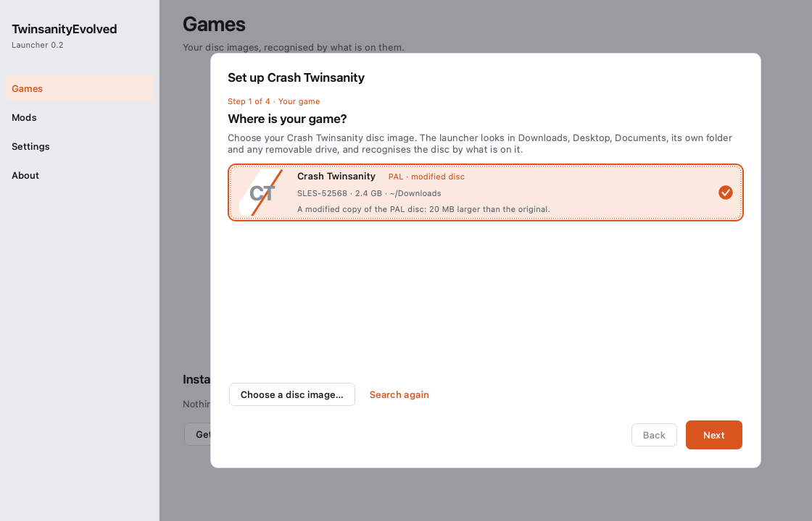
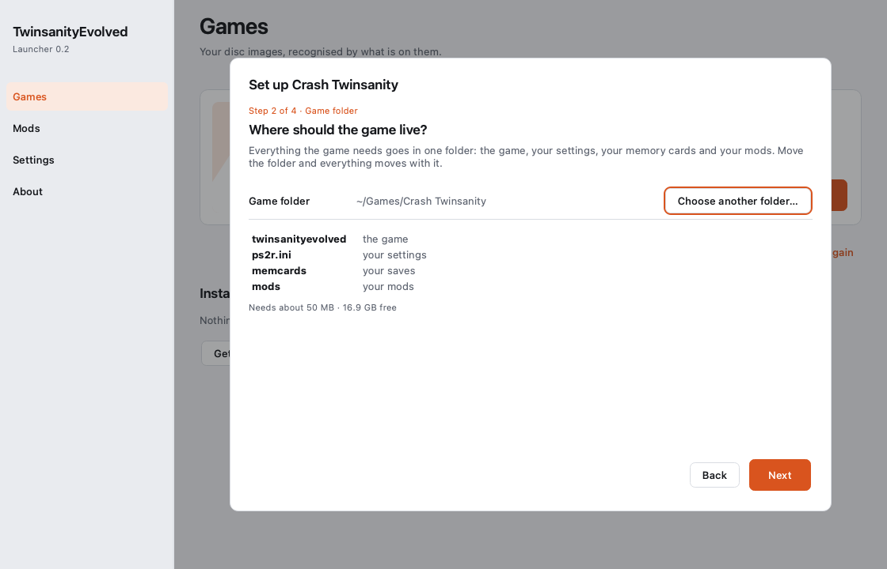
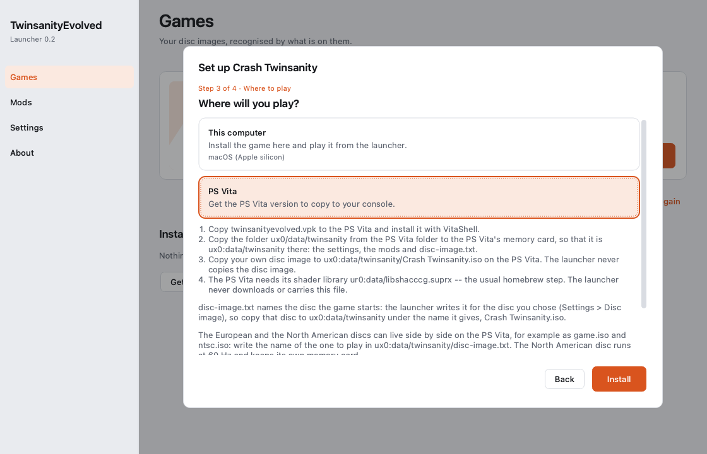
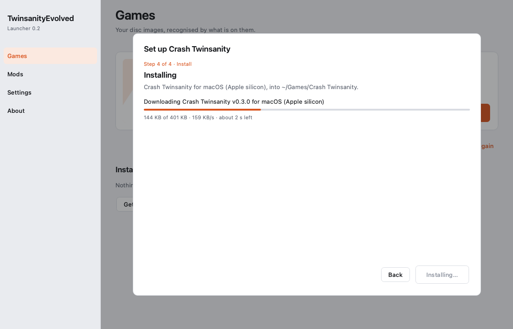
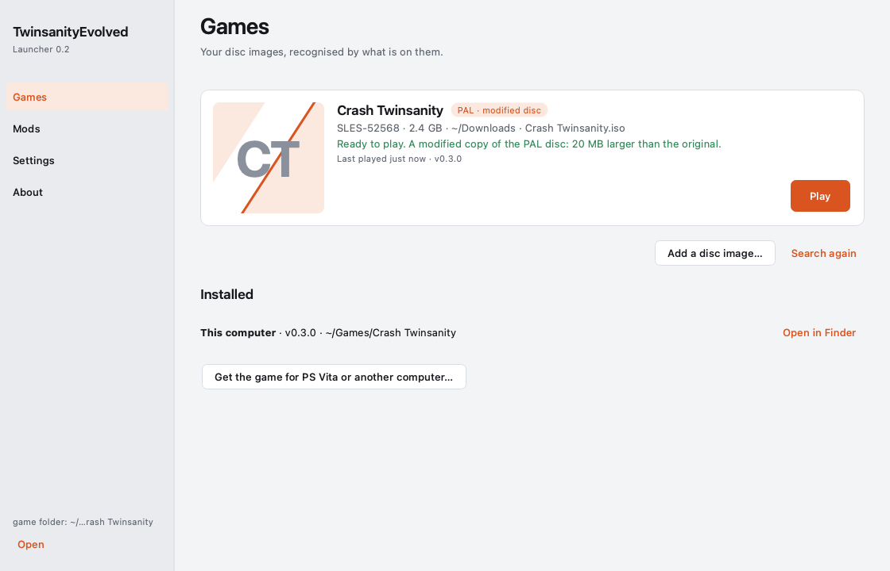
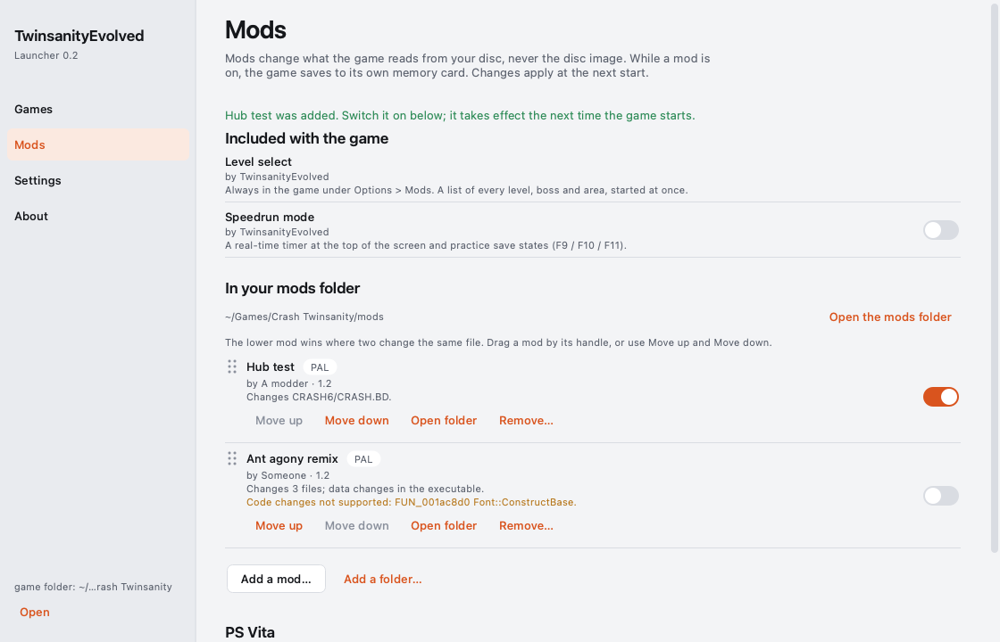
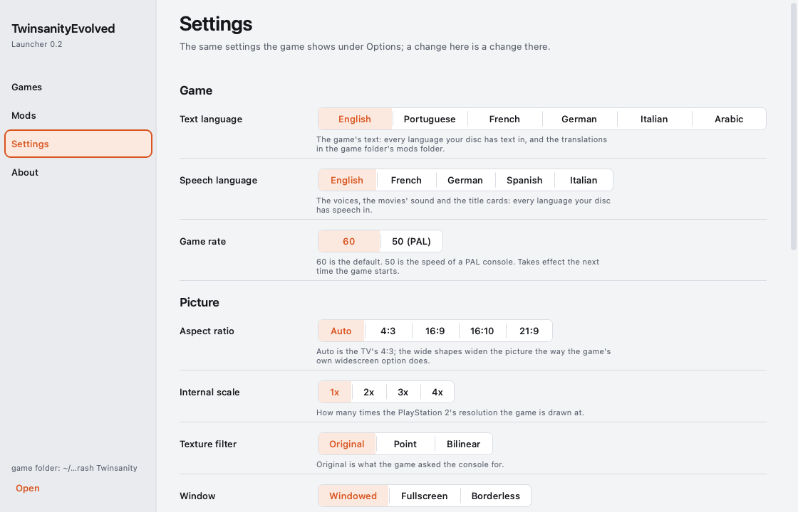
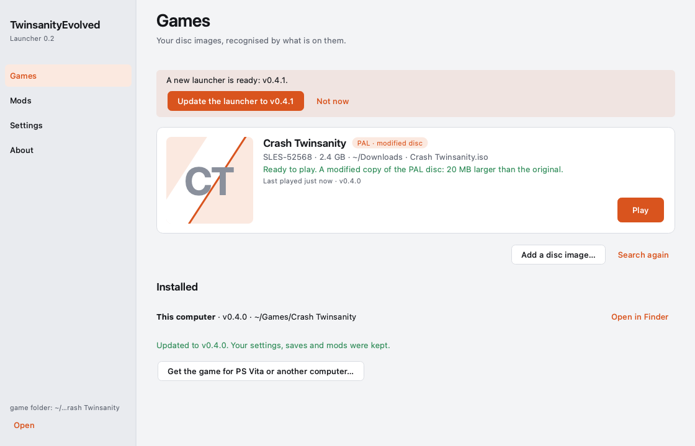
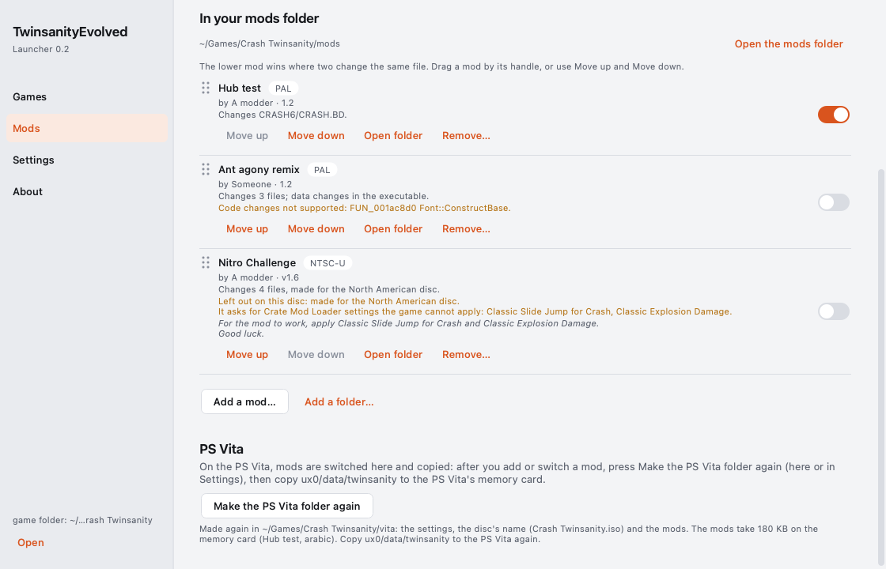

# TwinsanityEvolved

Native PC port of Crash Twinsanity: the [twinsanity-reversed](https://github.com/Smartkin/twinsanity-reversed)
decompilation (`game/`) running on the NativeEE engine (`engine/`).
The game is compiled to wasm32 and lowered to C with wasm2c; its linear memory is the engine's 32 MB main memory; the
decompilation's own `include/platform/*.h` is the only seam. On the PS Vita the game's code is compiled natively for the
console's ARM processor instead, with the same seam and the 32 MB as a block of the program. No game data of any kind is in
this repository — you need your own disc image, which is read at run time.

## What's new

Since v0.1.8 (the full list for players is in [RELEASE-NOTES.txt](RELEASE-NOTES.txt)):

- **The launcher installs the finished game** for Windows, macOS, Linux or the PS Vita from the releases, into one game
  folder that holds the game, your settings, your memory cards and your mods.
- **The North American disc plays**, and every disc is recognised by its content against the known dumps of the
  original discs.
- **Mods:** mods packaged as Mod Crates are supported, as are patched disc images, xdelta / PPF / BPS patches, folders of
  files and single archive files, added on the launcher's Mods page or with the mod tool.
- **Languages:** the text and the speech are two settings, and the game's texts can be read in Arabic.
- **PS Vita:** a package in every release, the PAL console's 50 Hz game loop, its movies, shadows and title sequence
  fixed, and a steadier, faster picture.
- **Fixed:** at 50 Hz the game no longer plays in slow motion, on every system.

## Play: download the game

1. From the latest release, download the zip for your system: `twinsanityevolved-<version>-windows-x64.zip`,
   `-macos-arm64.zip` (Apple silicon), `-macos-x86_64.zip`, `-linux-x86_64.zip` or `-linux-aarch64.zip`.
2. Unzip it anywhere you like, on any drive.
3. Start `twinsanityevolved` (`twinsanityevolved.exe` on Windows). The first time, it asks for your disc image: choose
   your own Crash Twinsanity image (`.iso`) -- the **PAL** disc (SLES-52568) or the **North American** disc (SLUS-20909
   v2.00). That is all: nothing is installed, nothing else is downloaded, and nothing is written outside the game's folder.

The game remembers your disc in `disc-image.txt` and keeps its memory cards and settings in `userdata\` beside it
(an earlier install's `~/.twinsanityevolved` keeps being used if you have one). Deleting the folder removes everything.
The zip holds only the program, the mod tool (`twinsanityevolved-modtool`, see Mods), the Arabic language pack
(`mods/arabic`, see Arabic), their libraries and the licences: no game data, which is read from your disc while you play (every release
zip passes `tools/ci/asset_scan.py`, which fails on any disc file or game asset).

**50 Hz.** A PAL console runs the game at 50 frames a second; the port runs it at 60 by default. For the PAL console's own
50 ticks a second, open Options → graphic options → **game rate** and choose **50 hz (pal)**: it takes effect the next time
the game starts (the setting is `game.hz = 50` in `userdata/ps2r.ini`; `--hz 50` does the same for one run). The game moves
at the same real-time speed at either rate (its clock counts real time: each 50 Hz frame is 1/50 s of game time). At 50 Hz
the frame rate row's `60` shows every frame the game makes, i.e. 50 frames a second.

**Loading screens.** A load shows the game's loading picture for under a second. On the console a load takes about 12
seconds: its DVD drive reads the level's 13-21 MB at 2.2 MB/s, and the game's loader waits a second before it reads a part
of the level, once for the level and once more for the parts linked to it (that wait is meant for play, where a part of the
level is read only once you have stayed near it for a second). Here, while the loading picture is up, the disc image is read
at the speed of the device you play on, and the loader goes on as soon as its reads are in. What is left is the picture's
half-second fade-in and the time your machine needs to read and set up the level: LOAD GAME's two loads, the title's and
the hub's, take 41 frames each, 0.7 s on a recent Mac (the reload after a game over 1.1 s: the game over picture fades out
first); on the PS Vita a load takes what its memory card and processor need. The level is the one a console-paced load gives, only fewer frames pass. During
play the disc keeps the console's pace, so an area that streams in while you walk arrives a piece at a time instead of
stalling a frame. For the console's pace in the loads too, set `disc.speed = console` in `userdata/ps2r.ini`
(`--disc-speed console` for one run; a run with `--deterministic` uses it, as the judges do). The memory card messages
still show for their two seconds.

**The PS Vita's memory card.** The PS Vita reads your disc image from its memory card on a thread of its own, and while the
game plays the card is slower than the console's DVD drive (1.6-3 MB/s in reads of ~200 KB in the device logs). The game
streams a level's parts as you move: the bus chase at the end of Rooftop Rampage reads the next part, 6 MB, while you run
at it. So the parts a level's links lead to are read into memory as soon as you enter the part beside them, about a minute
before the game asks for them (up to 10 MB of them at a time, of a 16 MB budget); the rest of a file the game starts reading
comes off the card in reads of 1 MB; and when the card is late all the same, the game plays on and the part arrives a few
frames later, as from a slow DVD, instead of the picture stopping until the card has it. The game's log has the card's figures: `[te.io] card:`
once at start-up (its speed by the size of a read), and in every window `[te.io] ... the game waited for the card N times`
(none in play is the aim), `read ahead: ...` and `[te.stream] ... reads put off for the card`. To try a card that slow on a
computer or in Vita3K: `TE_DISC_ASYNC=1 TE_DISC_SLOW_MS=53` (53 ms for every 128 KB read; on the PS Vita in `args.txt`);
`TE_STREAM_WAIT_CARD=1 TE_DISC_AHEAD_MB=0` puts back the old way (the game waiting for the card, nothing read ahead) for a
comparison. `TE_CHUNK_LOG=1` (on by itself on the PS Vita) writes a line each time a part of the level changes: its files
waiting, loading or loaded, and whether the picture drew it (`[te.io] chunk loaders @...`).

## The launcher

The launcher (`twinsanityevolved-launcher-windows-x64.zip`, `twinsanityevolved-launcher-macos-arm64.dmg` or
`twinsanityevolved-launcher-linux-x86_64.AppImage` on the release) does all of the above for you. You need two things:
your Crash Twinsanity disc image and the launcher. The first time it opens, one sheet asks four questions; nothing is
typed, and Back always works.

1. **Where is your game?** The launcher looks in Downloads, Desktop, Documents, its own folder and any removable drive,
   and recognises your disc by what is on it: the region (PAL, NTSC-U, NTSC-J) and whether it is the original disc --
   the whole image is compared with the known dumps of the original discs, a few seconds the first time -- or a modified
   copy ("PAL · modified disc"). Drop the file on the window, or choose it, if it is somewhere else.
2. **Where should the game live?** One folder, `~/Games/Crash Twinsanity` (`%USERPROFILE%\Games\Crash Twinsanity` on
   Windows) unless you choose another. The game, your settings (`ps2r.ini`), your memory cards (`memcards`) and your
   mods (`mods`) all live in it: move the folder and everything moves with it.
3. **Where will you play?** This computer, a PS Vita, or another computer (Windows, macOS, Linux).
4. **Installing.** The finished game for that machine comes from the latest release, is checked against the release's
   checksums and is put in the folder. Then **Play**.






After that the launcher has four pages: **Games** (your discs, each with Play; **Update** when a new version is out),
**Mods** (the mods that come with the game and the ones in your mods folder, each with a switch and a line saying what it
changes; drop a mod crate, a patched disc image, a patch file, a folder of files or one file of the game's archive on the
page to add it; drag the mods into order, the lower one wins where two change the same file; a change takes effect the
next time the game starts),
**Settings** (the game's own Options in plain language: the same `ps2r.ini` the in-game menu writes, so a change in one is
a change in the other; its **Text language** and **Speech language** offer what your disc carries, see Language) and
**About**.





**The launcher updates itself.** Each time it opens, the launcher looks for a newer launcher in the releases. When there
is one, the Games page says `A new launcher is ready: vX.` with **Update the launcher to vX**: the new launcher is
downloaded, checked against the release's checksums, put in the place of the one you opened, and opened again by itself;
your games, settings, saves and mods stay as they are (About has **Check for a newer launcher**). Where it cannot replace
itself -- a folder your account cannot change, such as Applications for a standard account, or the launcher opened
straight from its disk image -- it says why, and **Download it** opens the release's page. The game itself is updated as
before, with **Update** on its card. On macOS the launcher is not signed by Apple: after an update macOS may ask again
before the launcher reads a disc image in Downloads, Desktop or Documents.



**PS Vita.** Choose PS Vita in step 3 (or **Get the game for PS Vita or another computer…** on the Games page) and the
launcher makes a folder ready to copy, `vita/` in your game folder: `twinsanityevolved.vpk`, `README-vita.txt` with the
steps, and `ux0/data/twinsanity/` as the console's memory card has it -- your game folder's settings (`ps2r.ini`, without
the computer's own folders, picture size, window and game rate: the PS Vita has its own), a copy of the language packs and
of the mods you switched on, and `disc-image.txt` naming your disc's file name. Then:

1. Copy `twinsanityevolved.vpk` to the PS Vita and install it with VitaShell.
2. Copy `ux0/data/twinsanity` to the PS Vita's memory card, so that it is `ux0:data/twinsanity` there.
3. Copy your own disc image into `ux0:data/twinsanity/` under the name `disc-image.txt` gives (the launcher never copies the
   disc image; without `disc-image.txt` the game starts `ux0:data/twinsanity/game.iso`).
4. The PS Vita needs its shader library `ur0:data/libshacccg.suprx` -- the usual homebrew step. The launcher never
   downloads or carries this file.

After you import a mod, switch one on or off or change a setting, **Make the PS Vita folder again** -- at the foot of the
Mods page, under PS Vita, and on the Settings page -- brings the folder up to date (only what changed is copied); copy
`ux0/data/twinsanity` again. Mods are added and switched on the computer, never on the PS Vita. The launcher's About page
has the whole PS Vita flow in six sentences. On the PS Vita, `ux0:data/twinsanity/disc-image.txt`
switches discs: two can sit side by side (`game.iso` and, say, `ntsc.iso`) and the file's one line names the one the game
starts with (a file name beside `game.iso`, or a full `ux0:` / `uma0:` path). The North American disc plays there as on a
computer -- at 60 Hz (the PS Vita's 50 Hz default is the PAL disc's), with its own memory card
(`ux0:data/twinsanity/memcards-SLUS-20909`) and English only in the two language rows; the mods in
`ux0:data/twinsanity/mods` and the Arabic language pack work as they do on a computer. Importing a mod is the launcher's
job, on a computer. The PS Vita's resolution row offers 1x or 2x: 2x, the console's maximum, runs at half the frame rate or
less, and a `ps2r.ini` that names 3x or 4x is read as 2x. The package runs the game's code natively on the console's ARM
processor.



The launcher keeps only its own notes (the discs it knows, its window, its logs) in its app-data folder
(`%LOCALAPPDATA%\TwinsanityEvolved` on Windows, `~/Library/Application Support/TwinsanityEvolved` on macOS,
`~/.local/share/TwinsanityEvolved` on Linux); deleting that folder removes them. The game folder is yours. Every screen
of the launcher is in `docs/launcher/screenshots/`.

## Mods

Mods change what the game reads from your disc, never the disc image itself. Add one on the launcher's **Mods** page (drop
it on the page, or **Add a mod…**) or with `twinsanityevolved-modtool`, which comes with the game, and switch it on there:
the launcher's Mods page is where the mods of your mods folder are switched, and the game starts with them in place. A
change takes effect the next time the game starts. What a mod is, is decided by what
is in it, never by its name; mods are taken as the community ships them:

- **Mod Crates** -- the community's usual shape, made for Crate Mod Loader: a `.zip` or a folder with `ModCrateInfo.txt`,
  `layer0/` (files of the disc) and `layer1/` (entries of the game's archive). A large crate (over a gigabyte) takes about
  half a minute to add. The author's notes in `ModCrateInfo.txt` are shown under the mod on the launcher's Mods page.
- **A patched disc image** (`.iso`): only the files that differ from your disc are kept.
- **A patch made against the original disc** -- xdelta, PPF or BPS: applied to a temporary copy of your disc (its free
  space is checked first; the copy is removed afterwards), then kept as the files that differ.
- **A folder of files** laid out like the disc, loose files such as a whole `CRASH.BD` + `CRASH.BH`, or a folder that is
  already a mod (`mod.json`).
- **One file of the game's archive** -- what the Twinsanity Editor writes: a level chunk (`.rm2`, `.sm2`), a picture
  (`.psm`), a text bank (`.txt`), passed around bare like a `Default.rm2`. It is placed by its name: the one entry of the
  archive with that name is replaced (`Default.rm2` becomes the mod `default`). A name several entries share
  (`English.txt`) is refused with them listed: put the file in folders named like the one it replaces.

Each becomes one folder of your mods folder (`<game folder>/mods/<id>/`, described by its `mod.json`), holding only
what the mod changes. Where two mods change the same file, the lower one on the launcher's Mods page wins.

**The same mod again replaces it.** A mod's id is its name (`My Level Pack` -> `my_level_pack`);
adding a mod whose id you already have -- a new version of it, or the same file again -- replaces the one you have once
the new one is complete. The launcher asks first ("Replace <name> <version>? The copy you have is removed
first."; Cancel adds nothing), the mod tool replaces it; the mod keeps its switch and its place in the order. A folder of
that name that is not a mod is never touched: the addition stops and says so.

```sh
twinsanityevolved-modtool import "a mod crate.zip" --iso "/path/to/your disc.iso" --mods "<game folder>/mods"
twinsanityevolved-modtool inspect "a patch.xdelta" --iso "/path/to/your disc.iso"       # what it is, without adding it
twinsanityevolved-modtool verify "<game folder>/mods/<id>" --iso "/path/to/your disc.iso"   # every file, byte for byte
```

**A mod is made for your disc.** Its folder records the files it was made over, and the game checks them when it
starts: a mod added with one disc and played with another (whose files differ) is left out, with a line in the game's
log. The European and the North American discs are different discs: a mod made for the North American disc carries the
`NTSC-U` badge on the launcher's Mods page, and on a European game folder its row says "made for the North American
disc"; when it was made over that disc's files (an imported crate's archive is), the game leaves it out at its start and
the row says so in amber: "Left out on this disc: made for the North American disc." One file of the archive made for
the other disc is refused when it is added ("... it was made for the European disc").

**A crate made for the North American disc and added over the European one** plays with the European disc's text files:
texts its level scripts add to the North American file (`Language\AgentLab\American.txt`, which the European program
never reads) are not there, so the signs that show them stay empty, and the game's log names each one
(`[te.mods] tolerated: a script shows text 110, the scripts' text file has 100 lines: shown empty`). Added over the
North American disc, the crate has all its texts.

**Not supported** -- refused with a sentence saying why, or listed under the mod:

- **Code changes in a modified executable.** A mod's `SLES_525.68` is used for its data (tables, texts, numbers: those
  apply), but this port runs its own code, not the executable's: changed code is listed under the mod on the launcher's
  Mods page ("Code changes not supported: ...") and does not apply (new code a crate adds is such a change).
- **`ModCrateSettings.txt`** -- the property edits Crate Mod Loader makes to the game's code -- and crates with scripts.
  The same settings asked for in a crate's notes ("apply Classic Slide Jump for Crash and Classic Explosion Damage")
  cannot be applied either: the mod is added, and its row says so in a warning.
- **xdelta patches with secondary compression** (`-S djw`, `fgk` or `lzma`; xdelta3 3.1 with LZMA support uses LZMA by
  default): apply such a patch yourself (xdelta3, Delta Patcher) and add the patched image.
- RAR and 7-Zip archives, CHD / CSO / ECM images, `.cue` sheets, UPS and IPS patches, encrypted zips; emulator texture
  packs and cheat codes (they are not disc content).

**The built-in mods** come with the game, off by default:

- `level select` — one row that opens the list of the game's levels, bosses and areas at once; choosing one starts it through
  the game's own saved-level path (from the main menu as a new game would, from the pause menu with the current progress). The
  level starts with the character its own start gives, alone: nothing of the level left comes along (Cortex beside Crash, the
  Rollerbrawl of Cavern Catastrophe).
- `speedrun mode` — one real-time timer (mm:ss.cc) in the game's font, centred at the top of the safe area, started at NEW
  GAME or the first level entered. The in-game time and a split on every level entry / exit are written into a
  `--record-pad` recording (`# split …` lines: a recorded run carries its timer and its splits). Practice save states on a
  ring of 8: F9 saves, F10 loads the newest in place, F11 the one before (`~/.twinsanityevolved/practice/`); F12 or Mods >
  speedrun > reset to run start resets.
- `infinite lives` — while it is on, a death costs no life: the lives panel still comes up at each death, showing the number
  it showed before, and the restart at the checkpoint never ends in a game over. The game's font has digits only, so there is
  no infinity sign: the count simply stops going down. Lives you collect still count (a hundred wumpa fruit, an extra life).
  Switched off, the count goes on from where it is.

**In the game**, OPTIONS > MODS lists the built-in mods, which apply at once: `level select`, `speedrun mode : off|on` and
`infinite lives : off|on`.
The mods of your mods folder are not on it: they are switched on the launcher's Mods page (or with `mods.<id>.enabled` in
`ps2r.ini`) and the game starts with them in place (a change made while the game runs takes effect at its next start). A
language pack (the Arabic one) is not a mod: it is on neither Mods page and is chosen as a text language (see Arabic).
While ANY mod is on, the game saves to its own memory card (`memcards-mods`, seeded from the vanilla
card the first time): a modded save never touches the vanilla card. In `ps2r.ini`: `mods.<id>.enabled = on|off` and
`mods.order = id,id,...`; `--mod <id>` switches one on for a run.

## Discs

The game and the launcher recognise a disc image by what is on it, never by its file name:

- **The original disc** is a known retail dump: the whole image -- its size, CRC-32 and SHA-1 -- matches one of
  redump.org's (`launcher/discs/redump.json`: the European SLES-52568 v1.01, the North American SLUS-20909 v1.00 and
  v2.00, the Japanese SLPM-65801). The launcher reads the whole image once (seconds; remembered) and shows
  `PAL · original disc` or `NTSC-U · original disc`; the game compares the size at every start, and the whole image with
  `--verify-disc`.
- **A modified copy** -- the original program with other files, such as a translation patch -- shows
  `PAL · modified disc` and plays as the original does. The disc this port was made with is one: a PAL image with a
  Portuguese translation patch, 20 MB larger than the original. Which files it changes cannot be named: the repository
  holds only the dumps' sizes and hashes, no file list of an original disc.
- **An unrecognised version** -- the game's files with a program that is no known release -- is accepted with a warning
  (`PAL · unrecognised version`).
- **The North American disc plays** (`NTSC-U · original disc`, SLUS-20909 v2.00): there is nothing to do but choose it.
  The port runs the European program's code; the North American program's data is laid out at the European addresses
  through an address map built into the game (`launcher/discs/region_map_SLUS-20909.json`: addresses and names only, no
  byte of either disc), at 60 fields a second (`game.hz = 50` does not apply), in its one language (English, with its own
  voices), with its own movies, and with its own memory card (`memcards-SLUS-20909` beside `memcards`). What it cannot
  have is the North American program's own code changes: the game plays them the European way.
- **The Japanese disc, and the North American v1.00 disc,** are recognised but **not playable in this version**: each
  needs its own address map, made once from two discs by someone who has both:

  ```sh
  twinsanityevolved-modtool region-map --pal "/path/to/the European disc.iso" --disc "/path/to/the other disc.iso" --out region_map_<serial>.json
  ```

  Put the map beside the game (or pass `--region-map FILE`).

## Arabic

The game's texts in Arabic: every menu, notice and hint (305 texts, our own translation), drawn right to left in Arabic
letters made for this port in the game's lettering style. It is a **language pack**, not a mod: `mods/arabic` in this
repository and in every release zip, which the launcher puts into your game folder's `mods/` when it installs or updates
the game (a copy you removed or changed is left alone); without the launcher, copy the zip's `mods/arabic` into your mods
folder (the Vita: `ux0:data/twinsanity/mods/arabic`). There is nothing to switch on: while it is in the mods folder,
OPTIONS > GAME OPTIONS > **TEXT LANGUAGE** offers **arabic** after the disc's text languages (and the launcher's Settings,
**Text language**, offers **Arabic**). It is on neither Mods page, and the game keeps saving to your usual memory card.

- **The speech** is the SPEECH LANGUAGE row's: any language your disc speaks (English unless you choose another).
- The credits, the title cards and the legal screen are the disc's pictures in the speech's language, and a few memory card
  messages the game's program carries itself stay English.
- It is offered only on a disc whose English texts are the ones it translates (made on a PAL disc, SLES-52568); on another
  disc (the North American one) it is simply not offered.
- To redo the translation, or to make another language: `tools/text/README.md` (and **Languages** further down this page).

## Play from a terminal

```sh
# the PAL disc (SLES-52568): the decompilation is the PAL executable; the image is read at run time only
twinsanityevolved --iso "/path/to/Crash Twinsanity (Europe).iso"      # play: a window at the TV's 4:3, the boot movies, 60 Hz logic
twinsanityevolved --iso "...iso" --skip-movies                        # straight to the legal screen / title
twinsanityevolved --iso "...iso" --language french                    # the text AND the speech language (english default): see Language below
twinsanityevolved --iso "...iso" --text-language portuguese           # the text's language alone for one run (game.text_language)
twinsanityevolved --iso "...iso" --speech-language spanish            # the speech's language alone for one run (game.speech_language)
twinsanityevolved --iso "...iso" --aspect 16:9                        # the picture's shape for one run; see Display below
twinsanityevolved --iso "...iso" --mc-dir ~/.twinsanityevolved/memcards  # the memory card folder (default: userdata/memcards beside the game)
twinsanityevolved --iso "...iso" --hz 50                              # the PAL console's 50 Hz for one run (default 60; game.hz in ps2r.ini)
twinsanityevolved --iso "...iso" --present-ct16                       # the retail look: the frame shown as the PS2's dithered 16-bit copy
twinsanityevolved --iso "...iso" --fps-counter on                     # the shown fps + game Hz top-right in the game's own font
twinsanityevolved --iso "...iso" --disc-speed console                 # the loads at the console's pace for one run (device by default; console under --deterministic); see Loading screens
twinsanityevolved --iso "...iso" --frame-rate 120                     # the presenter's cadence for one run (30|60|120|144|240|uncapped); see Frame rate below
twinsanityevolved --iso "...iso" --mod level_select                   # a built-in mod on for this run (not persisted); see Mods below
twinsanityevolved --iso "...iso" --mods-dir "<game folder>/mods"      # the mods folder for this run (default: beside ps2r.ini)
twinsanityevolved --iso "...iso" --verify-disc                        # the whole image against the known dumps at boot (seconds); see Discs
```

Release zips (`twinsanityevolved-<platform>.zip`, one per platform) contain the game, the mod tool
(`twinsanityevolved-modtool`), this README and the licences. Unzip and run the command above with your disc image.
Closing the window quits.

**Display.** The title's OPTIONS > GRAPHIC OPTIONS page carries the port's display rows beside retail's centre screen and
widescreen: aspect ratio (auto = the TV's 4:3 / normal / wide / 16:10 / ultra-wide (21:9) / super wide (32:9)), resolution (1x..4x: the PS2's own size and its multiples), texture filter
(original / point / bilinear), vsync, display mode (windowed / fullscreen / borderless) — applied at once and written to
`~/.twinsanityevolved/ps2r.ini` (`video.aspect`, `video.scale`, `video.texture_filter`, `video.vsync`, `video.fullscreen`;
the centre-screen move as `video.custom_offset_x/y`). The aspect ratio is the picture's shape, and with the game's own
WIDESCREEN row on it is also the shape the game draws for: at wide (16:9) the game draws as on a 16:9 TV, at 16:10, 21:9
and 32:9 it draws that shape -- the same height of the world, more of it at the sides -- with the movies at their own shape
in the middle, and at 21:9 and 32:9 the menus and the HUD keep a 16:9 TV's layout in the middle of the picture. With
WIDESCREEN off the game draws for 4:3 and the picture is that frame stretched to the shape. The page's last row is the FPS COUNTER (labelled "fps overlay", off by
default): the SHOWN fps over the game Hz, top-right, drawn with the game's own menu font; `display.fps_counter` in ps2r.ini,
`--fps-counter on|off` for one run.

**Resolution.** The RESOLUTION row draws the picture at the PS2's own size (1x) or at 2, 3 or 4 times its width and
height. At 4x the European disc's 512 by 512 picture becomes 2048 by 2048: 16 times the PS2's pixels (3x is 9 times, so
4x is 1.8 times 3x). The game's mist, the 10th dimension's haze, the waterfalls and the explosions are see-through
layers drawn over the scene, and each layer is drawn over every pixel it covers, so where they pile up the graphics
chip's work grows with the resolution: a computer that holds 60 frames a second at 3x can drop below 60 at 4x there. If
it does, choose 3x.

**Cutscenes at 4x.** A 4x picture has 16 times the PS2's pixels. On an Apple M4 the cutscenes keep 60 frames a second at
3x; at 4x the Psychetron's cutscene after Madame Amberly draws a couple of hundred large glowing layers over each other
(up to 28 screens' worth of blended pixels a picture) and held about 34 before the fast fragment program, 60 with it; the
bear's ride on Totem Hokum ends with a few slow pictures; on a slower GPU these two fall behind first. The cutscenes that read the next
area while they play, such as the walk from the core's entrance into the lab, no longer stall at a camera cut when the GPU
is behind: their textures are prepared ahead of their first use, as on the PS Vita, instead of the game waiting for each
one.

**Shadows on crates.** Crash's shadow falls on the top of a crate he stands or jumps over; on the PS2 it never falls on a
crate. The PS2's picture is the reference for everything else, and this is the one place the port departs from it on
purpose. Why the PS2 refused it: the shadow is a column cast straight down from the character to a fixed depth below his
feet, and the GS darkens every pixel inside it, so through a crate the column darkens the top and also a band down the
side it passes and a line along the bottom rail's ledge. The artists turned the shadow off on every crate's material (FBA,
the frame alpha's top bit that the shadow volumes skip), and that lost the top too. The port keeps that bit on everything
the column should not darken and clears it only on a crate's floors: the triangles that face up (within 45 degrees of
straight up, the game's own floor bound) with no part of the crate above them, found once per model by a ray up from each
triangle's centre. The bottom rail's ledge faces up too but lies under the top's rim, so it keeps the bit, as the sides do.
The same rule applies to any upright object whose material sets FBA; a tilted one, and every character's skin,
stays as on the PS2. The triangles are drawn in their own order, so nothing else in the picture changes by a single pixel
(`tools/judges/crate_shadow_judge.py`). `video.shadows_on_crates = on|off` in ps2r.ini (on by default; off gives the PS2's
picture exactly), `--shadows-on-crates on|off` for one run.

**Frame rate.** The same page's FRAME RATE row (after VSYNC): 30 · 60 · 120 · 144 · 240 · uncapped, default 60; applied at
once, written as `video.frame_rate` in ps2r.ini, `--frame-rate <value>` for one run. The game always runs at normal speed:
its logic ticks at exactly 60 Hz whatever the row says (the census's `game_hz 60.0`, no catch-up, no slow motion) and
produces the same 60 pictures a second — the row decides how those pictures are SHOWN.

- **30** shows every other picture at a steady cadence (no interpolation).
- **60** shows every picture as the game makes it (today's behaviour).
- **120 / 144 / 240** present at that rate, paced by a high-resolution timer (on Windows the waitable timer, never Sleep);
  the frames between two game pictures are interpolated — the camera's position, orientation and field of view, every
  rigid object's position, rotation and scale, the characters' skins — from the two real pictures, never ahead of them
  (one game tick of added latency, measured and reported). With VSYNC on the display's refresh is the effective cap
  (a 60 Hz display shows 60 of the 120): the page says so under the row while one of these is selected.
- **uncapped** presents every frame the renderer can make, interpolated, and forces vsync off for the session: the VSYNC
  row reads "off (uncapped)" and cannot be changed until another rate is chosen.

Text, the HUD, the pause and options menus, the FMV pictures and the title's orb are always the newest picture's. The runner's exit lines carry the presenter's row
`present=rate:shown_fps:interp_frames:snaps:latency_ms:late_presents`.

**Frame rate on the PS Vita.** The Vita's screen is 60 Hz and its FRAME RATE row is the game's own cadence instead:
**auto (60/30)** (the default) runs the game at 60 while its ticks fit a refresh and otherwise locks it to a steady 30
(20 in the heaviest scenes): each tick then spans two (three) refreshes of game time -- the game integrates by time, as the
PS2 game does when it drops frames -- every picture is drawn and the display holds each one exactly that long, so the
picture moves evenly instead of swinging between 20 and 60. **60** and **30** fix the cadence. The loading screens, the
boot and the movies always run one refresh per tick. The setting is `display.tick_lock = auto | 60 | 30` in ps2r.ini
(`--frame-rate auto|60|30` for one run; `TE_VITA_TICK_LOCK=auto|60|30|20|ab` in args.txt overrides it, `ab` alternating
auto and 60 every 600 presents for a comparison); the log's `[te.vita.lock]` lines give the cadence of every window.

**Drawing on the PS Vita.** Repeated meshes of a picture (a roof's tiles, a fence's posts: Rooftop Rampage's distant roofs are 2,500 repeats of 450 small meshes) are drawn as one draw each on the PS Vita, sorted into their groups across the opaque scene (`TE_GFX_VITA_SORT=full`, the default there). The picture differs only where two opaque surfaces tie exactly in depth -- a few dozen pixels of a picture by a few levels; `TE_GFX_VITA_SORT=safe` keeps the exact order (the groups joined only where no draw lies between) and `=off` draws every mesh on its own, as before.

**The PS Vita's game rate is the PAL disc's own 50 Hz.** On the Vita `game.hz` defaults to 50 (a ps2r.ini without the key,
or none yet); Options → graphic options → **game rate** writes it (`60` or `50 hz (pal)`), taken at the next start. An
args.txt replaces the built-in arguments: its own `--hz` decides for its run, or `game.hz` / the default 50 when it names a
ps2r.ini, or 60 with `--config none`; the log's first lines say which (`vita: game rate 50 Hz (the Vita's default 50:
ps2r.ini has no game.hz)`, `(ps2r.ini game.hz = 60)`). At 50 Hz the game loop ticks 50 times a second as the developers'
PAL loop did, paced by a 20 ms timer, and the 60 Hz screen shows every picture from the first refresh after it is ready
(four in five held one refresh, one two). The game's clock counts real time at either rate (the timer it reads gives 576000
counts a second: 11520 a 50 Hz field, 9600 a 60 Hz one), so Crash moves at the same speed in the same seconds at 50 and 60;
every `[te.vita.lock]` line ends with the game time against the wall time of its window (`game time vs wall: ... 100.0 %;
drift ... ms`). The FRAME RATE row then reads **auto (50/25)** | 50 | 25: auto falls back to a steady 25 (two 20 ms fields
a tick, as the PAL game drops a frame) while the ticks do not fit their 20 ms, and comes back once a second of them would.
The movies run at their 25 pictures a second (two ticks each), the loads at the disc's speed (the drive model's frame is
20 ms at 50 Hz). `TE_VITA_LOCK_DOWN50`, `_UP50_MS` and the other knobs of `platform/nativeee/host/te_tick_lock.h` tune the
fallback.

**Language.** The text and the speech are two settings, two rows of OPTIONS > GAME OPTIONS (and of the launcher's
Settings):

- **TEXT LANGUAGE** -- every menu, notice and dialogue line: the languages the disc has text in, recognised by what each
  text bank CONTAINS (a translated disc may carry a language under another slot's name: the PAL image this port was made
  with keeps Portuguese in the `English` slot and the English text in the `Spanish` slot -- english still means English
  text), english first, then the language packs in the mods folder (see [Arabic](#arabic)). Applied at once.
- **SPEECH LANGUAGE** -- the voices, the movies' sound track, a level's voices, and the disc's pictures that go with them:
  the title cards, the legal screen and the credits pictures. The languages the disc has a speech bank `Crash6\<name>.mb`
  for (english, french, german, spanish, italian on the PAL disc; english on the North American one); a language pack
  never adds one. The front end's speech changes at once, the movies' sound and a level's voices at the next movie or
  level.

On a retail disc the same language in both rows is exactly the console set to it. Any text goes with any speech: Portuguese
text with Spanish voices, Arabic text with French voices. The settings are `game.text_language` and
`game.speech_language` in `ps2r.ini` (default `english`; `--text-language` / `--speech-language` for a run). The older
`game.language` (and `--language`) names one language for both when the two are not set -- a language with text but no
speech of its own speaks English (`portuguese`), one with speech but no text reads English (`spanish`); its older form
`game.language = arabic+french` is read as text arabic, speech french and rewritten as the two keys. A choice in the game's
menu writes both keys.

**Mods.** See [Mods](#mods): `--mod <id>` switches one on for this run (not persisted), `--mods-dir DIR` names the mods
folder for this run.

**Controls** (the engine's `default_bindings.ini`; a DualShock-layout gamepad works as-is):

| PS2            | Keyboard / mouse                       |
|----------------|----------------------------------------|
| left stick     | W A S D                                |
| right stick    | mouse (camera)                         |
| d-pad          | arrow keys (menus)                     |
| cross          | Space                                  |
| square         | Left Shift                             |
| circle         | right mouse button                     |
| triangle       | E                                      |
| L1 / L2        | 1 / 2                                  |
| R1 / R2        | 3 / 4                                  |
| L3 / R3        | 5 / 6                                  |
| start / select | Y / Tab                                |
| (save state)   | F5 saves the game, F8 loads it back    |

**Cutscenes.** CROSS skips the in-game cutscene that plays, the first time too, except in the cutscenes listed below: there
CROSS does nothing and the cutscene plays as watched. Every cutscene of the game is a script: a director that moves the camera
and tells its characters what to do, the characters' own scripts, the doors, switches and items it sets. A skip does not play
the cutscene faster. From CROSS the screen goes black and the scripts go on running their own commands in their own order, once
a frame, while each of the cutscene's timed waits (a pause, a timed move or turn, an animation a script waits for) ends as soon
as the one before it, in the order and at the frames they end at when the cutscene is watched; a character going round a loop
of its own (an animation played again and again) keeps its own pace. For the frames a wait's end passes over, the cutscene's
characters (the player among them) still get their own updates, one for each of those frames: their moves, animations, walks
and falls, and the triggers they cross; when the cutscene waits for a character the physics carries (Cortex rolling through the
pipe in Boiler Room Doom) and nothing else is in the physics, the physics runs those frames too. The cutscene's speech and its
characters' sounds are not played. The game's clock, the rest of the physics and everything outside the cutscene keep their
pace; the skip usually takes a fraction of a second, and it is over when the cutscene's script ends it. What the cutscene
leaves is meant to be what watching it leaves: where the player and its characters are, the flags, counters, items, modes and
music it sets; each cutscene was watched and skipped and the two compared, and CROSS skips only those where the two end alike.
Alike means: the flags, counters, items, modes and music exactly; the player and the characters where watching leaves them, or
nearer to it than two watchings of the cutscene on the PS Vita end apart; and what moves on the world's own time (a missile in
flight, a wumpa fruit's bob, a nitro crate's hop, a penguin dropped at a random moment of a character's idle) may be elsewhere,
each such thing named in the check with its reason. What a skip cannot give is the cutscene's seconds to the world around it (a
platform's cycle, a wandering creature is where it was). If a skipped cutscene ends up waiting two seconds on nothing it
drives, the rest of it plays on as watched. The cutscenes' own unfinished skip branches stay unused, as in the retail game. The
movies are skipped with CROSS as before.

Of the game's 51 cutscenes, 48 can be skipped. In these 3, CROSS does nothing:

- **A skip would not end it as watching does:** the blimp leaving the Iceberg Lab (its end hands Crash to the transfer to the
  airship, which waits for the airship's area to be read from the disc: after a skip the game would play on for those seconds).
- **Not a cutscene a skip can shorten:** the title's flyby over the beach (it plays behind the title screen, where CROSS is not
  a skip, and play never starts it) and the way from the core's entrance to the lab (the level transition: most of it is the
  next area being read from the disc).

Some directors play several cutscenes: one in each chunk they are in, or a boss fight's start and its end. Where only one of
them was checked, CROSS skips that one and does nothing in the others: the training director's other six cutscenes on
N. Sanity Island, the emu farmer's other one there, the cavern director's other five in Cavern Catastrophe, the totem
director's other four on Totem Hokum, the Slip Slide shed director's other one, Rooftop Rampage's second, and the ends of the
Tikimon, Henchmania, Dingodile and Evil Twins fights (with whatever those fights play in between), and the phases of Madame
Amberly's fight.

**Save states.** F5 saves the running game to `savestates/slot0.ps2st` in the game folder (the folder that holds the
`ps2r.ini` in use: the launcher's game folder, `~/.twinsanityevolved` for a terminal's default settings; `paths.save_dir`
in `ps2r.ini` names another folder, `save.slot` another slot), F8 loads it back where it was saved; the game answers at the
bottom of the screen for two seconds ("state saved to slot 0", "state loaded from slot 0", "no saved state in slot 0") and
in its log (`[twinsanityevolved] savestate: ...`). A state belongs to the build that wrote it and loads in a later session
too (a play run starts without address-space randomisation for that; `TE_NO_RESPAWN=1` opts out, and then a state loads
only in the session that saved it). Not on the PS Vita (no keyboard, no save-state mechanism there). The speedrun mod's
practice states (F9 / F10 / F11) are separate.

**Settings** live in `~/.twinsanityevolved/ps2r.ini` (created on the first play run; `--config PATH` / `--config none`),
or in the game folder's `ps2r.ini` when the launcher made one (it passes `--config <folder>/ps2r.ini`):
the two languages (`game.text_language`, `game.speech_language`; the older `game.language` read for both when they are
absent), the game rate (`game.hz`), the display rows (`video.*`, `display.fps_counter`), the shadows on the crates' tops
(`video.shadows_on_crates`, see Display; not on a menu), the disc speed of the loads
(`disc.speed = device | console`, see Loading screens; not on a menu), the PS
Vita's frame-rate lock (`display.tick_lock = auto | 60 | 30`, read by the PS Vita version), the mods
(`mods.<id>.enabled`) and the game folder's own folders (`paths.memcards`, `paths.mods`: relative to the folder when
inside it); every row is also changed from the title's OPTIONS menu and applied at once, and from the launcher's
Settings page. One setting of the file alone, not on a menu: `game.route_steps = reached | retail` -- reached, the
default, lets a script's chaser reach the route's step the disc's script data makes it miss (Evil Crash in Bandicoot
Pursuit, who on the console stops at the first step of the chase and no longer follows Cortex); retail keeps the
console's stop. Save files: `~/.twinsanityevolved/memcards` (vanilla) and `memcards-mods` (while any mod is on); practice
states `~/.twinsanityevolved/practice/`.

**Game rules** (`ps2r.ini` only, not on a menu; the speedrun mod's runs keep the original game's rules for both):

- `game.slide_steering = fixed | retail` (default `fixed`). A knee slide turns toward the stick's direction for its first
  moments; in the last frame of that steering the original game divides by the part of the frame left before the steering
  ends, so at 60 Hz that frame turns the slide far past its direction (tens of degrees; on the 60 Hz console a different
  amount every slide). `fixed` takes the time left as no less than half a frame, so that frame turns at most twice its share
  of the angle, as at the PAL disc's 50 Hz, where the original game does not swing and nothing changes. `retail` keeps the
  swing.
- `game.invincible_to_explosions = on | off` (default `off`). The third Aku Aku mask makes Crash invincible for 8 seconds:
  enemies and other hits take nothing, but the original game lets a hit of 50 or more through, and every explosion's is 100
  (a nitro or TNT crate kills an invincible Crash). `on` spares an invincible character explosions too, as the classic games'
  Aku Aku did.

**Reporting a problem:** report what you see with the binary's build id (`BUILD-ID` beside it in a release
zip, or the commit it was built from), the level and a screenshot -- and, when you can, an F5 save state taken right
there (`savestates/slot0.ps2st` in the game folder) and the play log.

## Build

```sh
git clone <this repository> && cd TwinsanityEvolved   # engine/ and game/ are in the tree: nothing else to fetch
tools/fetch_toolchain.sh                 # pinned wasi-sdk 24.0 + wabt 1.0.42 + libclang (sha256 in tools/toolchain/PINS.sha256)
cmake -S . -B build -G Ninja && cmake --build build
build/twinsanityevolved --iso "/path/to/Crash Twinsanity (Europe).iso" --dry-run
build/twinsanityevolved --iso "...iso" --run-seconds 10 [--deterministic] [--hz 60] [--mc-dir DIR] [--no-sdl-input]
ctest --test-dir build -L nativeee        # the platform/nativeee unit tests (one per seam header)
build/twinsanityevolved --iso "...iso" --deterministic --no-sdl-input --play-pad fixtures/padlogs/hub_entry.padlog \
    --save-state /tmp/hub.ps2st@2380 --stop-at 2600    # a save state at boundary 2380; --load-state /tmp/hub.ps2st resumes it
build/twinsanityevolved --iso "...iso" --record-pad my.padlog     # record pad 0 (inputs only, and the run's disc speed: a replay keeps it -- a log without that line
                                                                  # was recorded at the console's pace; --pad-script FILE for authoring `hold` lines)
build/twinsanityevolved --iso "...iso" --deterministic --play-pad P --trace-bodies 1   # the physics bodies every boundary (TE_TRACE_BODIES_ALL=1)
tools/ci/savestate_roundtrip.sh --iso "...iso"      # the save-state gate: save in the hub, load, identical trace/frames/census
build/twinsanityevolved --iso "...iso" --deterministic --skip-movies --play-pad fixtures/padlogs/hub_entry.padlog --stop-at 4200 \
    --harness-out /tmp/leg      # the engine's hash streams: frames.fhash, audio.ahash, run.meta (+ state.trace, frames.pdesc)
python3 tools/oracle/diff.py --padlog fixtures/padlogs/hub_entry.padlog --out /tmp/oracle_diff \
    --attributions tools/oracle/attributions/hub_entry.tsv    # the check against the recompiled reference
tools/ci/build_all.sh --iso "/path/to/Crash Twinsanity (Europe).iso"    # all CI gates
tools/ci/judges.sh --iso "...iso"                                       # the regression judges on build/twinsanityevolved
```

Requires CMake ≥ 3.21, Ninja, Python 3, a host C/C++ compiler, SDL2 and FFmpeg (the engine's dependencies), and
`/usr/local/vitasdk` for the armv7 syntax lane (`--no-vita` skips it). License: MIT for this repository's code (`LICENSE`);
`engine/` carries its own (`engine/LICENSE`).

### The launcher

The launcher is the engine's Qt 6 application (`engine/app/launcher`) with this title's `launcher/title.json` and the
disc tables in `launcher/discs/` (the known retail dumps `redump.json`, cited from redump.org; file lists made by
`tools/discs/manifest.py`, labelled by provenance; names, sizes and hashes only). It
installs the finished game from the releases and never compiles anything.

```sh
cmake -S engine/app/launcher -B build-launcher -G Ninja -DCMAKE_PREFIX_PATH=/opt/homebrew/opt/qt@6
cmake --build build-launcher && QT_QPA_PLATFORM=offscreen ctest --test-dir build-launcher --output-on-failure
build-launcher/ps2r_launcher.app/Contents/MacOS/ps2r_launcher --manifest launcher/title.json
PS2R_SCREENS_OUT=docs/launcher/screenshots PS2R_SCREENS_MANIFEST=$PWD/launcher/title.json PS2R_SCREENS_ISO="$ISO" \
    PS2R_SCREENS_ISO2="<North American image>" PS2R_SCREENS_PACKS=$PWD/mods \
    QT_QPA_PLATFORM=offscreen build-launcher/test_launcher_screens          # every screen, as docs/launcher/screenshots/
python3 tools/judges/launcher_cold_judge.py --launcher-build build-launcher --game build/twinsanityevolved --iso "$ISO" --out /tmp/cold
python3 tools/judges/launcher_settings_judge.py --launcher-build build-launcher --out /tmp/settings
tools/ci/release_launcher.sh --qt /opt/homebrew/opt/qt@6                    # the signed .app and the .dmg
tools/ci/release_launcher_linux.sh --qt ~/Qt/6.8.3/gcc_64                   # Linux x86_64: the AppImage (linuxdeploy, pinned)
```

### Cutscenes

The census of the game's cutscenes and the check that a skip leaves what watching leaves (ids, token types, counts and names
are all they print of the disc's scripts):

```sh
python3 tools/cutscenes/census.py run --iso "$ISO" --out /tmp/census     # TE_CUTSCENE_CENSUS=1 over every chunk of the archive
python3 tools/cutscenes/census.py report --logs /tmp/census --json census.json   # every CutsceneStart site, its skip branch, its commands
python3 tools/cutscenes/show.py /tmp/census/levels_ice_hub_psycho.log 6421       # one graph by its states, bodies and commands
python3 tools/cutscenes/verify.py --iso "$ISO" --list LIST.json --out /tmp/verify # per cutscene: a watched and a skipped leg, compared
python3 tools/cutscenes/reach.py record --iso "$ISO" [--only NAME]                # the reach fixtures fixtures/padlogs/cutscenes/*.padlog
python3 tools/cutscenes/compare.py W.log S.log                                     # the verdict over two TE_CUTSCENE_STATE logs
python3 tools/cutscenes/skip_table.py --fixture fixtures/judges/cutscene_skip_pal.json --list   # the cutscenes CROSS does not skip, and why
python3 tools/judges/cutscene_skip_judge.py --bin build/twinsanityevolved --iso "$ISO" --out /tmp/csj [--mechanism]  # every reached cutscene
```

`TE_CUTSCENE_STATE=N` logs the state a cutscene leaves (the progress, the counters, the music's tracks per slot, the chunks'
flags, the player, every instance's place, flags and running behaviours) every N boundaries; `TE_CUTSCENE_START=NAME[:MESSAGE]@BOUNDARY` gives a loaded
director the behaviour its trigger starts (a test's way into a cutscene without walking to it). The game logs each skip
(`[te.cutscene] skip over after N frames ...` and the agents it drove), and each cutscene it will not skip (`[te.cutscene] the
cutscene of site N cannot be skipped: ...` as it starts, `[te.cutscene] not skipped: ...` at CROSS).

What "leaves the watched state" means is the fixture's rule (`compare.py --rule`, written by the judge from the fixture's
`rule` and the cutscene's `allow`). Exact: the progress, the counters, the chunks' flags, the music, the player's chunk and mode
(the low 16 bits of the character's state word; the high 16 are unused) and the judged instances' flags and behaviours.
Places: within the `floor`, 0.035 units: two watchings of one cutscene in play mode (no `--deterministic`) end the player up
to 0.0334 apart where the cutscene puts him down -- on the Vita, whose frames of two and three fields move an interpolation's
end; 0 on the desktop, where no frame lost a field; further where he ends falling, on a slope or on a board, which a cutscene
that needs it allows itself -- or within a `classes` bound (a wumpa fruit's 0.25 bob). Allowed per cutscene (`allow`:
an agent's name, what of it, the reason, optionally `within` a bound, `settles` by +N boundaries and `from` +N): what runs on
the world's time and is not the cutscene's outcome; the name `player` is the player's place (a level that starts on a slide)
and `music:SLOT` a music slot (a cutscene's speech track, which a skip does not play, ending after the watched cutscene).
Every difference the rule allows is printed with its size and its reason.

The reach fixtures (`fixtures/padlogs/cutscenes/cutscenes.json`, one entry per cutscene a test reaches: its chunk, the save's
point of the story, the autopilot's steps) are recorded by `tools/cutscenes/reach.py`: the steps run closed-loop with
`--record-pad`, and the recording is the fixture. Some cutscenes need play no test can do (a boss fight won, a route a long way
up a level, a vehicle steered through a chase): a test may then ask the game for a few things, which the game carries out with
its own code at the start of a frame of play (`Platform::System::NextTestRequest`; `game/testrequests.h`). They are test tools:
nothing is asked unless a plan or the knob below asks, and the PS2 never asks. The autopilot's plan steps:

- `teleport X Y Z [NAME]` -- the player (or the instance whose object is NAME) warped to (X, Y, Z) in its chunk's frame, as a
  script's PositionWarp warps one; a rider's vehicle starts again there;
- `message NAME ID [FROM]` -- the user message ID sent to NAME's instance from FROM's, as a script's SendUserMessage sends one;
- `counter N V [NAME]` -- the game counter N (0..999) set to V, or with NAME that instance's own counter N (0..3), as a script's
  SetCounter sets one;
- `hitpoints N [NAME]` -- the player's (or NAME's) hit points set to N (0..255), as a script's SetHitPoints sets a character's
  (2 is Aku Aku's first mask, 3 the shining one: the next mask picked up makes the character invincible);
- `until-graph NAME GRAPH [STATE] [MAX_FRAMES]` -- the plan waits until NAME's instance runs that behaviour graph (at that state).

Each request is logged as `[te.test] b BOUNDARY: SPEC`; `reach.py` writes a recording's as the entry's `test`, and the legs of
`verify.py` and the judge replay them with `TE_TEST_ACTIONS=SPEC@BOUNDARY;SPEC@BOUNDARY...` (each at the first boundary of play
from its boundary on). `TE_TRACE_MOVES=1` adds the probe's `[move]` lines: every boundary of a knee slide (its state, the time
into it, the facing's and the slide's yaw) and every change of the played character's hit points and invincibility, with the
last contact's kinds and damage.

Which cutscenes CROSS may skip is the table the game asks (`Platform::System::CutsceneSkippable`: for each graph a director's
runner runs as its cutscene starts, and at CROSS for each graph the cutscene's agents run;
`platform/nativeee/host/cutscene_skip.cpp`). The build makes the table of the judge's fixture
`fixtures/judges/cutscene_skip_pal.json` (`tools/cutscenes/skip_table.py`; `--list` prints the cutscenes that cannot be
skipped and why): each of the 51 cutscenes by its site and the graphs only it runs, its status (`pass`, or `refused` with the
reason), a skippable one's graphs its checked legs never ran (`unverified`: refused) and how a test reaches it.
`TE_CUTSCENE_SKIP_ALL=1` skips every cutscene without the table: what `tools/cutscenes/verify.py` measures by default
(`--with-table`: the game as it ships). `tools/judges/cutscene_skip_judge.py` (the judges' feature set) runs every cutscene of
the fixture a test reaches, four at a time: a skippable one must leave the watched state, play on and be shorter than watching
it; a refused one must play exactly as watched when CROSS is pressed. `--mechanism` also skips each refused one without the
table and names those whose skip now leaves the watched state (their status may become `pass`).

### Mods and the mod tool

`twinsanityevolved-modtool` is built with the game (`cmake --build build --target twinsanityevolved-modtool`); its library
`engine/app/host/mod_import` is the launcher's Mods page's too; `tools/judges/mods_import_judge.py` and `mods_overlay_judge.py` judge them on a disc.

### Languages

A language pack's text bank is made from a table of translations by `tools/text/translate.py` (any language written in
Windows-1256; the Arabic one is `tools/text/arabic.tsv` -> `mods/arabic/data/arabic.bank`: the game's 305 texts and the
port's own two row titles, TEXT LANGUAGE and SPEECH LANGUAGE, `port:000` / `port:001`), its glyphs by `tools/font`:

```sh
tools/text/translate.py --iso "$ISO" --language arabic --extract /tmp/arabic-batches   # the English, masked, in batches (outside the tree)
tools/text/translate.py --iso "$ISO" --language arabic --replies /tmp/arabic-answers   # the translations back (a person or an LLM)
tools/text/translate.py --iso "$ISO" --language arabic --fit                           # break the lines to fit the game's boxes
tools/text/translate.py --iso "$ISO" --language arabic --check                         # every text present, current and fitting
tools/text/translate.py --iso "$ISO" --language arabic                                 # the bank
tools/font/build_arabic_font.py                                                       # mods/arabic/data/arabic.font from the typeface
```

`tools/text/translate.py --help` lists the options (the prompts, the glossary, the translation endpoint).

### PS Vita

```sh
cmake --preset vita-release && cmake --build --preset vita-release      # VITASDK=/usr/local/vitasdk: build-vita-release/twinsanityevolved.vpk
cmake --preset vita-module-release && cmake --build --preset vita-module-release   # the wasm2c build, for an A/B
```

`vita-release` is the PS Vita package the release attaches: the game's code compiled natively for the console's ARM
processor by the SDK's GCC (`tools/te_cxx_arm.py`, `cmake/native_lane.cmake`; no wasm32 toolchain needed).
`vita-module-release` builds the game the way the computers do (wasm32, then wasm2c's C) into `build-vita-module/`.
The Vita3K recipe that compares the two builds picture for picture, and what differs between them, follow.

#### The two builds, picture for picture, in Vita3K

The recipe compares the draw lists of every picture (`TE_GFX_DRAWHASH=1`: one line per picture with a hash of every draw's
state, vertices, mesh parameters and skin palette in submission order), the played character every 30 boundaries
(`--trace-player 30`) and the game states (`--trace-state`). Vita3K's picture read-back is empty, which is why the draws are
hashed instead of the frames; its timing is not the console's, which a `--deterministic` run does not depend on.

1. Build both packages: `cmake --preset vita-release && cmake --build --preset vita-release`, and the same with
   `vita-module-release` (`build-vita-release/twinsanityevolved.vpk`, `build-vita-module/twinsanityevolved.vpk`).
2. The routes' memory cards, made on the computer (`build/` is the desktop build):

   ```sh
   TE_GFX_HEADLESS=1 TE_GFX_NO_DRAW=1 build/twinsanityevolved --iso "$ISO" --deterministic --no-sdl-input --no-audio \
       --skip-movies --play-pad fixtures/padlogs/hub_entry.padlog --mc-dir /tmp/mc_hub --stop-at 2700
   python3 tools/warp_save.py --card /tmp/mc_hub --chunk 'levels\school\rooftop\roof01' --out /tmp/mc_roof01 --place 0xFFFF
   python3 tools/warp_save.py --card /tmp/mc_hub --chunk 'levels\school\sch_hub\sch_hub' --out /tmp/mc_schhub --place 0xFFFF
   ```

3. Into Vita3K's `ux0:data/twinsanity/` (`~/Library/Application Support/Vita3K/Vita3K/fs/ux0/data/twinsanity/` on macOS):
   the disc image as `game.iso`, the pad logs `fixtures/padlogs/hub_entry.padlog`,
   `fixtures/padlogs/entries/school_rooftop_roof01.padlog` and `school_sch_hub_sch_hub.padlog`, and a FRESH copy of the
   route's card for every run (the game saves to it): an empty folder for the hub, `/tmp/mc_roof01` or `/tmp/mc_schhub`.
4. One run per build and route, `args.txt` (the hub's; the others name their pad log and card):

   ```
   --iso ux0:data/twinsanity/game.iso --mc-dir ux0:data/twinsanity/mc --config none --skip-movies --trace-state --no-kbm
   --deterministic --play-pad ux0:data/twinsanity/hub_entry.padlog --stop-at 4200 --trace-player 30 TE_GFX_DRAWHASH=1
   ```

   `tools/vita/vita3k_run.sh --vpk build-vita-release/twinsanityevolved.vpk --seconds 300` (`VITA3K=` names the emulator's
   binary: the arm64 build where there is one, see below), then keep
   `ux0:data/twinsanity/twinsanityevolved.log`; the same with `build-vita-module/twinsanityevolved.vpk`. A run ends with
   `--stop-at: exit 0` in the log (Vita3K then exits on its own teardown).
5. `tools/vita/lanes_compare.py module.log native.log`: the pictures both reached, identical or not, the first that differ;
   the probes and the game states, a line that differs only in an 8-digit hex word counted apart (the module prints a guest
   offset where the native build prints a pointer). `TE_GFX_DRAWHASH_AT=N` is not in the tree: a picture that differs is
   found draw by draw with a local listing of `SubmitBuckets`' hash parts.

What the two builds give: the same game states on every route, the same probes but the loading screen's (below), and every
picture identical but the user interface's turned and curved shapes (below).

**Vita3K does not keep the console's rounding exactly.** The game thread runs with FPSCR = round toward zero, flush to zero,
default NaN (the EE's arithmetic). The x86_64 Vita3K build (here under Rosetta 2) returned round-to-nearest results from the
host's sine under that FPSCR at start-up, and compared a denormal as above zero on one build and not on the other; the arm64
build applies an FPSCR change one JIT block late (a division right after `vmsr` rounded the previous way). Two runs of
different code can therefore differ in a last bit where the console would not, and the two emulators do not even agree on
the game's timeline (the arm64 build's clock matches the desktop's at the loading screen, the x86_64 build's does not). Use
the arm64 build where there is one, read a difference in a last bit as unproven, and settle it on the console: the same
recipe there (the log is `ux0:data/twinsanity/twinsanityevolved.log`), both packages, one route.

#### What differs between the two builds

- **Out-of-range float-to-integer casts** gave different answers until `tools/te_cxx_arm.py`'s rewrite R8: the module's code
  (clang for wasm32) guards every conversion -- INT_MIN for a float that does not fit an s32, 0 for a u32 -- where the
  Cortex-A9's VCVT saturates. The HUD's turned sprites read an uninitialised wobble base (`SpriteWidget::Construct` with an
  anchor never sets it; 1.6e34 for the lives head), so the head was turned by -2.8 degrees in the module and +2.8 natively in
  the first seconds of every level. `platform/nativeee/native/int_cast.h` gives the native game the module's answers (the
  PS2's CVT.W.S saturates as the Cortex-A9 does; the reference here is the module, the desktop's code).
- **Still differing in Vita3K**, the game states and the scenery identical: the title's and the menus' rings and the HUD's
  turned head at rest, each by one bit in a few vertices (the arm64 build: 160 of a ring's 4608 vertices, one unit in the last
  place), and the played character's place on the loading screen before the level's chunk exists, -0 natively where the
  module has +0. Whether either is the emulator's rounding or a real difference of the two compilers (each folds the
  constant float expressions it can see at build time to the nearest, while the game rounds toward zero at run time) only the
  console's own pair of logs can tell.

#### The native build's risks

- **The 32 MB block has no guard page.** It is the first 32 MB of the program's .bss (the retail data symbols at their
  addresses in it), with the program's own globals after it; the PS Vita has no page protection a program can set
  (`psp2/kernel/sysmem.h` has none), so the block cannot have an unmapped neighbour. A game access past the 32 MB corrupts
  those globals or faults. The module build is no safer on the console: its memory accesses are unchecked there
  (`TE_VITA_UNCHECKED_MEMORY`, since 2026-10-22), only the computers' module traps.
- **A NULL read faults.** In the module a game pointer is an offset into the 32 MB, so reading through NULL reads the
  block's first bytes and the game goes on; natively a game pointer is a pointer, and address 0 is unmapped. A latent read
  through NULL that the PS2 and the module tolerate ends the native game ("the application has crashed", a core dump).
- **Undefined C++ the two compilers answer differently**, besides the float casts above: a shift by 32 or more (wasm takes
  the count modulo 32, ARM's register shift gives 0), an integer division by zero (the module traps, the native division
  returns a value and the game goes on), an uninitialised local (a wasm local starts at 0; natively it is what the register
  or the stack held). Whether one of them is behind the loading screen's -0 above is not known.
- **Save states** exist on neither PS Vita build (`runner/te_savestate_null.cpp`: every save and load says "save states
  are not available on this target"), so none passes between the two; on the computers a state is tied to the build that
  wrote it (the CRC-32 of the program). The memory cards are the game's own saves: the two builds write the same bytes but for two
  words where the game stores two of its heap pointers (an offset into the 32 MB in the module, a pointer natively), and
  each loads a card the other wrote and plays on (Vita3K: LOAD GAME into the hub, both ways).
- **The GPU lock-up of v0.9.1.** A player's console ended v0.9.1's native package with "render gpu crash": the GPU stopped
  in the pixel phase of an alpha-tested draw of the frame target. The one console-only GPU difference was the fill census
  of the built-in diagnosis set (`TE_GFX_VITA_FILL`), out of the built-in arguments since (an `args.txt` token still turns
  it on); Vita3K does not count visibility, so it is not proven to be the trigger. The drawing code is the same in both
  builds, so the module build is exposed the same way.

### Windows

The Windows lane is its own preset family (nothing above changes): clang-cl + Ninja through
`cmake/windows-clang-cl.toolchain.cmake` (the engine's clang-cl shim, vcpkg for SDL2 / FFmpeg / the GL headers), the
pinned toolchain through `tools\fetch_toolchain.ps1`.

Prerequisites: Visual Studio 2022 (or its Build Tools) with "Desktop development with C++" and "C++ Clang tools for
Windows"; CMake 3.24 or newer; Python 3 on PATH as `python`; Git for Windows; and a bootstrapped vcpkg checkout that
contains the manifests' `builtin-baseline` commit (`git -C <vcpkg> fetch`, then `bootstrap-vcpkg.bat`). Open a
"Developer PowerShell for VS 2022" and set `VCPKG_ROOT` there: the developer shell sets its own `VCPKG_ROOT` (Visual
Studio's bundled vcpkg), which is too old for the pinned baseline. The first configure builds FFmpeg from source
(10-60 minutes; cached afterwards). The game needs a GPU driver with OpenGL 4.1 core (any current NVIDIA, AMD or Intel
driver; not a remote-desktop session).

```powershell
powershell -ExecutionPolicy Bypass -File tools\fetch_toolchain.ps1     # pinned wasi-sdk + wabt (sha256), native PowerShell
cmake --preset windows-clang-cl-release                                 # VCPKG_ROOT set; Developer PowerShell for VS 2022
cmake --build --preset windows-clang-cl-release -j 8
ctest --preset windows-clang-cl-release                                 # every nativeee test incl. the Win64 fiber arm
build-windows-release\twinsanityevolved.exe --iso "D:\Crash Twinsanity.iso"
.\tools\ci\release_dist.ps1 -SkipBuild                                # dist\windows-x64\ + the zip (the CI job's artifact)
```

## Release artifacts

`tools/ci/release_dist.sh` (macOS / Linux) and `tools/ci/release_dist.ps1` (Windows) build the shipped shape — the pinned
wasm32 toolchain, the engine's static LGPL FFmpeg and static SDL2 (`TE_DIST=ON`), the runner and the mod tool — and stage
`dist/<platform>/` (`twinsanityevolved`, `twinsanityevolved-modtool`, `mods/arabic`, BUILD-ID, README, LICENSE, third-party
notices + licence texts, `fixtures/padlogs/`) plus `dist/twinsanityevolved-<platform>.zip` + `.sha256`; the asset scan runs over
the folder and the staging refuses a GPL FFmpeg. `.github/workflows/release.yml` runs the same scripts on a `v*` tag
for macOS arm64 / x86_64, Linux x86_64 / aarch64 and Windows x64 (the Windows job runs the unit tests on Mesa's llvmpipe,
the runner having no GPU; a platform whose job fails is named as missing in the release's notes and the others are still
attached; `.github/workflows/windows.yml` is the Windows build lane on its own), the PS Vita's `.vpk` (the `vita` job, the `vita-release` preset: the program with the game's code compiled natively, the shipped shader cache and the LiveArea's pictures -- the bubble's icon, the start picture, the page's background and gate from `tools/vita/livearea/`, the game's cover and promotional art, which the asset scan exempts by name) and, through `.github/workflows/launcher.yml`, the launchers (`tools/ci/release_launcher.ps1` /
`.sh` / `_linux.sh`: the Windows zip, the macOS `.dmg`, the Linux AppImage). Its release job attaches every file with one
`SHA256SUMS` to the tag's one DRAFT release, whose notes are `RELEASE-NOTES.txt`; it is published by hand:

```sh
git tag vX.Y.Z && git push origin vX.Y.Z      # the workflow runs; the draft collects every file and SHA256SUMS
gh release edit vX.Y.Z --draft=false          # publish it once checked (the launcher installs published releases only)
```

Offline Linux: `docker build -f tools/ci/linux.Dockerfile -t te-linux . && docker run --rm -v "$PWD:/src"
-w /src te-linux tools/ci/release_dist.sh --jobs 3`. Development shape (Homebrew / apt packages, bundled into `lib/`, not
shippable): `tools/ci/release_dist.sh --system-deps`.

## Graphics diagnostics

The runner opens a window at `Platform::Graphics::StartRenderer` and presents the frame at the display's rate.
Environment knobs of `platform/nativeee/host/graphics.cpp`: `TE_GFX_HEADLESS=1` (hidden window), `TE_GFX_UNPACED=1` (no
vertical-blank pacing), `TE_GFX_DUMP_DIR=dir` + `TE_GFX_DUMP_EVERY=n` / `TE_GFX_DUMP_AT=k` (presented frames as PPM),
`TE_GFX_LOG=1`, `TE_GFX_SUMMARY_EVERY=n` (the counters line the judges read), `TE_GFX_DUMP_TEXTURES=dir`,
`TE_GFX_DIAG_MIP_TINT=1` (every texture's levels below the first given in magenta: the surfaces drawn from them show it),
`TE_GFX_VITA_LEVELS=authored|gpu|none` (the PS Vita: the levels below the first sampled from the PS2's own levels -- the
default, as on a computer -- from the GL library's levels made from level 0 on the GPU, as earlier releases did, or none),
`TE_GFX_VITA_KEEP_DEPTH=always` (the PS Vita: every frame's depth kept across ANY end of its GPU scene -- stored at each
scene's end, loaded at the next -- not only across a screen copy's, as by default; what the sky drawn after the opaque scene
needs should anything else end the frame's scene; `=0` keeps it across nothing), `TE_GFX_VITA_INSTANCE_INDICES=N` (the PS
Vita: no instanced draw of more than N indices -- a longer run of a repeated mesh drawn as several instanced draws in its
order; no plain draw asks for more than 49152; the log's `gxm draws refused` line names, a window at a time, the draws the
GPU library refused and the largest instanced draw), `TE_GFX_VITA_INSTANCING=skip` (the PS Vita, diagnosis: the instanced
draws not made -- the picture a GPU that drew none of them would show, to set beside a console's photo),
`TE_GFX_RENDER_THREAD=0/1` (the frame's GL work on a render thread — on by default in play mode with a window),
`TE_TICK_LOG_MS=ms` (the clock logs every tick slower than that with its phases: draw submit / present / pump / game;
`TE_TICK_LOG_CAP=n`: at most n such lines a census window, then only the ticks of twice `ms` or more and the window's
longest so far, the others counted by their profile's top section in the window's `[te.load] ... slow ticks not logged` line),
`TE_PICTURE_LOG_MS=ms` (the drawing thread logs every picture slower than that -- its wait for the GPU, its drawing, its
present call -- with the drawing thread's sections under `TE_PROF=1`; `TE_PICTURE_LOG_CAP=n` as for the ticks),
`TE_NO_QOS=1` (the game, render and pacer threads at the default QoS instead of interactive), `TE_GFX_DEPTH_Z32=1` (the GS
Z mapped to the window depth as z / 2^32, the mapping before the exact one — z / 2^24, one depth step per GS Z unit, as the
GS's Z32 test compares them; the old one resolved 128 units and let near-coplanar passes z-fight: for A/B). Diagnosis knobs of the scene
(`host/graphics_scene.cpp`, `host/math_vu0.cpp`): `TE_GFX_CULL_ALL_OUT=1` / `TE_GFX_CULL_ALL_IN=1` / `TE_GFX_CULL_BOXES_OUT=1`
(the culling's answers forced), `TE_GFX_NO_DRAW=1` (culling without the models' and skins' draws), `TE_GFX_SKIN_DUMP=DIR`
(every skin / blend-part packet the engine's SkinGeometry refuses), `TE_GFX_DIAG_TEXT=1` (every text call: quads, tfx, colour,
glyph size, string), `TE_PARTICLE_DIAG=1` / `TE_PARTICLE_NOCULL=1` (every ParticleBlockView answer logged / the block culling
off), `TE_GFX_PARTICLE_UNCLAMPED=0|2` (the particle emitter with its VU clamps for every block / both forms run for every
block and their packets compared, a line every 1024 blocks; by default an ARM processor leaves the clamps out of a block
whose floats are all finite: the same packets), `TE_GFX_SHADOW_DIAG=1` (the shadow composite without its stencil test),
`TE_GFX_NO_SHADOWS=1` (volumes counted, never
composited), `TE_GFX_DIAG_FLOORS=1` / `=paint` (each FBA model part's floors, the up-facing triangles its own model covers and
the draws' runs, and the instances kept whole for not standing upright / those floors painted flat magenta: the pixels that
take the shadow on a crate), `TE_GFX_NO_DECALS=1`, `TE_GFX_NO_PASSES=1` (a material's first shader only), `TE_MATH_STUB=collision,rays,joints`
(those maths stubbed), `TE_GFX_DIAG_PRESENT=N` / `TE_GFX_DIAG_FLAT=1` (one present's model draws logged with state, screen
box, colours and the material's shaders / painted by clip mode), with `TE_GFX_DIAG_PRESENT=N`: `TE_GFX_DIAG_VERTS=1` (every
vertex of that present's draws logged: bucket, screen position, GS Z, depth test / write) and `TE_GFX_DIAG_MARK_BUCKET=a,b`
(those buckets' draws painted opaque magenta, depth test and write kept: the pixels they win, for the exact depth test
over the logged vertices), `TE_GFX_SKY_DIAG=A[,B[,S]]` (pictures A..B, every S-th: each draw's place to the sky drawn after
the opaque scene -- a held layer, the depth reset, drawn before the sky, the draw the sky is drawn before and why, after it --
with its state, its kind and its depth extent in GS z: a mesh's bounds through its matrix, a skin's joints, a vertex
draw's vertices -- on the PS Vita also a mesh's range and the instancing plan's word for it: the first of a group of N drawn
as one instanced draw, or joined to one; and a line a picture: the draws the sky waited for and the smallest depth among them),
`TE_MATH_RAY=retail|legacy` (the fast ray casts by the
engine's `title::RayMath` — the retail VU0 program as values, the default — or the earlier slow-path form),
`TE_MATH_RAY_COMPARE=1` / `TE_MATH_RAY_MICRO=1` (the retail 0xAB8 micro on the engine's VU interpreter counted against /
answering every cast), `TE_PARTICLE_VIEW=legacy` (the earlier particle block view for A/B).
`tools/vita/readlog.py LOG` turns a PS Vita log (`ux0:data/twinsanity/twinsanityevolved.log`, the console's or Vita3K's)
into markdown tables, one row per census window -- the pace, the threads' milliseconds, the GPU, the draws, the seams, the
bursts' particles and sound, the textures, the disc -- and the slow ticks and pictures, one by one and by their profile's top
section.

`TE_GFX_GPU_LIFETIME=1` (off by default; nothing is recorded when off): every free, re-specification and CPU write of GPU
memory the GL backend makes -- textures, the pool's storage, the mesh buffers, the vertex ring's slices, on the PS Vita also
vitaGL's uniform ring, its garbage collector's frees and the shader programs' code -- checked against what the GPU may still be
reading. On the PS Vita the last use is vitaGL's own record of the texture or buffer and the GPU's progress the scene fence
vitaGL passes to every scene's end; storage in flight that vitaGL does not defer is logged as `[te.gfx.vita] GPU LIFETIME:
... UNPROTECTED`, and each summary window ends with a `GPU lifetime` line of the counts (in flight, deferred, UNPROTECTED).
On a computer the driver keeps what the GPU reads: the same events are counted with the presents the GPU had not finished.

At the high resolutions (the RESOLUTION row's 2x..4x): `TE_GFX_GPU_TIMERS=1|phases|breaks` (the GPU phase timer: after every pace line, the GPU's
milliseconds, the pixels drawn and the drawing thread's time per phase of a frame -- the clear, the sky, the opaque scene,
the blended draws, the shadow volumes and their composite, the screen copies, the HUD, the present, and the window's worst
frame with its phases; `1` cuts at every phase,
or only where the frame's render pass ends on a tile-based GPU such as Apple's; not free there: the hub at 4x on an Apple
M4 presents 56 frames a second with it, 60 without), `TE_GFX_EAGER_TEXTURES=0` (the textures decoded on the game thread at
their load and made with the game thread waiting for the drawing thread, as before, instead of decoded ahead on the builders
and made between pictures -- the default on every platform; `TE_LOAD_CENSUS=1` prints what each window loaded and waited
for), `TE_GFX_SKY_LAST=0|abN` (the sky's layers drawn first, as before,
instead of after the opaque scene / switched on and off every N presents), `TE_GFX_SHADOW_REGION=0|abN` (the shadow
passes over the whole frame, as before, instead of the volumes' tiles only / switched), `TE_GFX_PS2_FAST=0|abN` (every
draw with the full PS2 fragment program, as before, instead of its fast form -- the same source with the arms no draw of
the port turns on folded away, the same pixels, 2.4 times faster per pixel on an Apple M4 / switched),
`TE_GFX_SCALE_AB=N` (the internal scale switched between the setting and 1x every N presents), `TE_GFX_DUMP_TARGET=1` (the
dumps at the frame target's own size, 2048x2048 at 4x, instead of the presented picture). A burst of explosions is the particles' fill: a 4x frame draws
16 times the PS2's pixels for each particle quad, and the roof's detonator under its 24 TNT and nitro crates draws about
24 frames' worth of particle quads at its peak -- 100 million pixels a frame at 4x, of the PS2's full fragment program
(on an Apple M4 the blended draws then take 7-10 ms of the GPU's frame instead of about 2). `TE_GFX_PARTICLE_CENSUS=1` (a line
per census window: the particle blocks, their triangles and the frames' worth of pixels they cover, in Mpx at the scale),
`TE_GFX_PARTICLE_CULL=0|abN` (the particle triangles that draw nothing -- every fragment fails the alpha test and is
discarded -- drawn as before instead of left out / switched every N presents: the same picture),
`TE_GFX_PARTICLE_SCALE=title|abN` (the additive particles -- the fire, the glows -- drawn at the PS2's own resolution into a
picture of their own and added to the frame: 1/16 of their pixels at 4x, the particles as soft as on the PS2, and an edge
of the scene in front of them decided per PS2 pixel -- a stair step up to four pixels deep along a crate shard's edge over the
fire at 4x; off by default; `frame` = the default; abN switched every N presents).

Judges: `tools/ci/judges.sh --iso IMAGE` runs every regression judge (`tools/judges/*.py` with `fixtures/judges/*.json`:
skins, shadows, the shadow on a crate's top, particles, decals, dust, the crystals, Ice Climb's cave passes against the exact
GS depth test, the textures made ahead of their use (two cutscenes that read their next area: nothing decoded or waited for on
the game thread, the pictures the synchronous path's), the orb,
the ocean, the heap layout, the fill a 4x frame draws where the fog and the waterfall are, display, language, mods,
speedrun, infinite lives, the pause screen's gem row, fps counter, voice pitch, the loads at the device's speed; the mods folder's disc overlay, the mod importer and the game's Mods page; the Arabic
language pack; `--set launcher`: the launcher's cold install, its Settings and Mods pages and the no-codenames lint; `--set
discs`: the disc identity, the region-aware loader and, with `--ntsc-iso`, the North American boot) and
`tools/judges/run_graphics_judges.sh` (the self-test frames; the legal screen and
the title's world). `tools/judges/padlog_judge.py RUN_LOG --fixture fixtures/judges/hub_entry_pal.json` judges the hub pad
log's replay (to 4200, Playing held, no trap, the small pages not exhausted); `tools/judges/movie_judge.py` the boot movies;
`tools/judges/hub_fps_judge.py --bin BUILD/twinsanityevolved --iso IMAGE` the hub's render rate in play mode (render fps p50 ≥
55, no tick > 16.7 ms outside the load windows); `tools/judges/frame_rate_judge.py --bin BIN --iso IMAGE` the FRAME RATE row
per setting (the shown fps within 3 % of the setting, game_hz 60.0 ± 0.1, the real pictures' hashes identical across the
settings, zero displacement violations); `tools/judges/interpolation_quality_judge.py --bin BIN --iso IMAGE` the interpolated
frames at 120 (the half-way frame against the pixel mean of its two real neighbours, SSIM ≥ 0.95 on the hub, the intro
cutscene and a cavern run). The runner prints the game's heap at exit (`heap: pool … small pages used N
of M`); `tools/ci/build_all.sh` runs every gate (`TE_MIN_FREE_GB` lowers its 15 GB disk floor).
